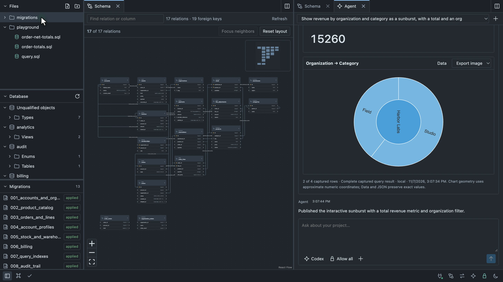
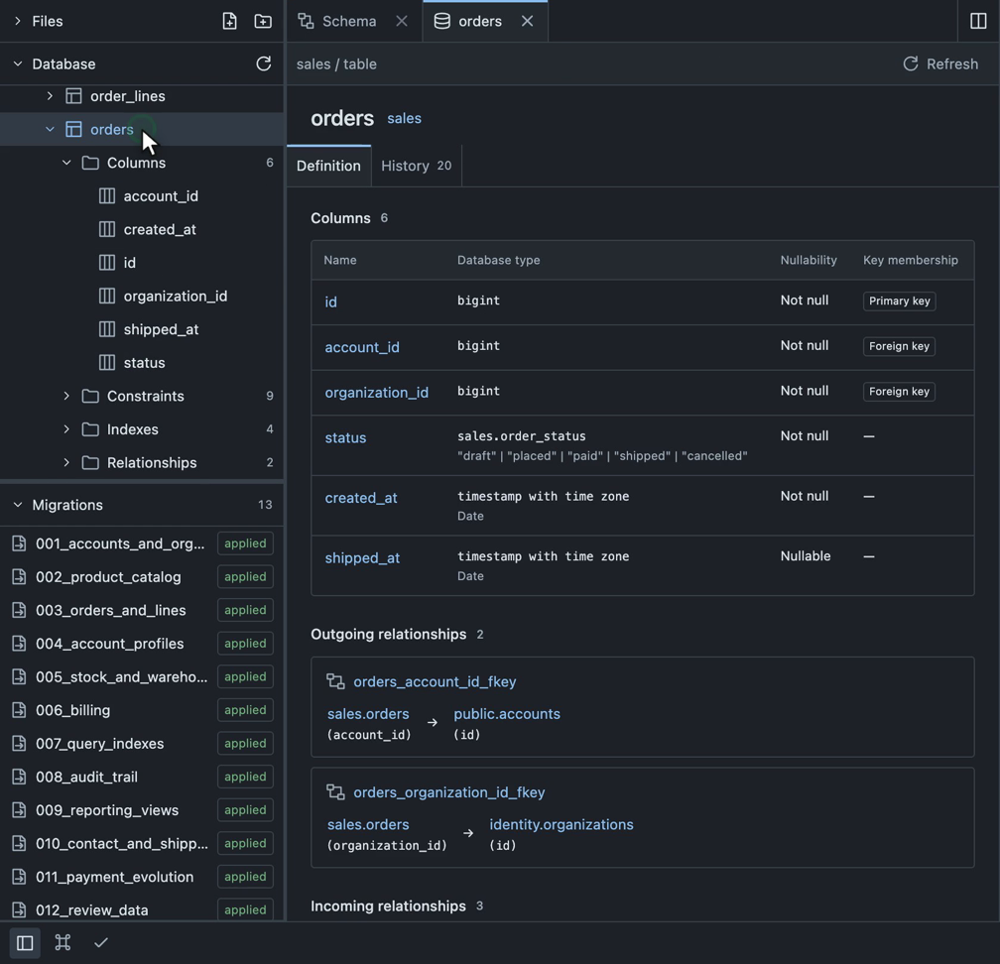
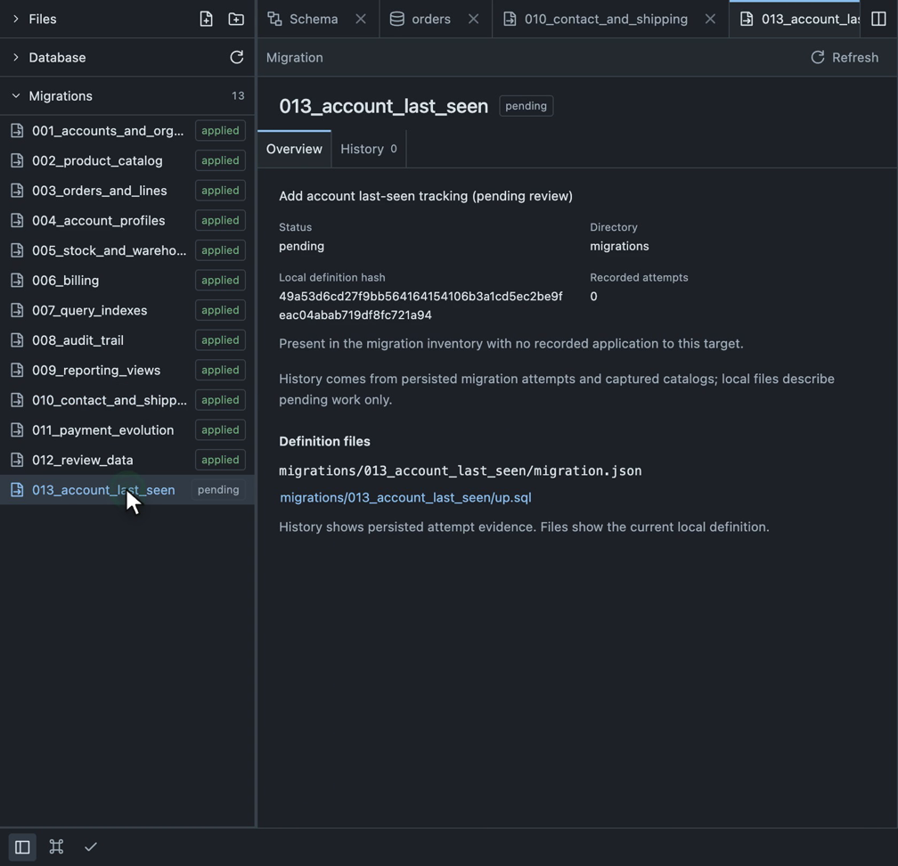
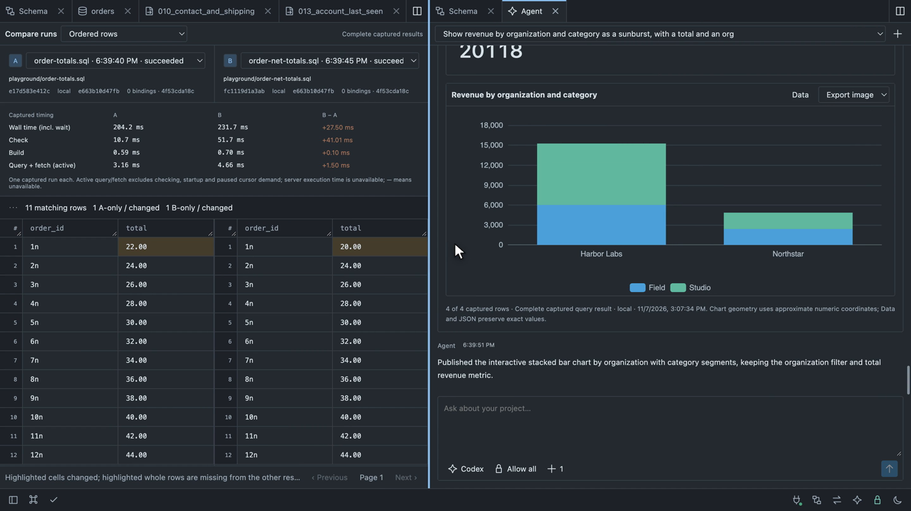
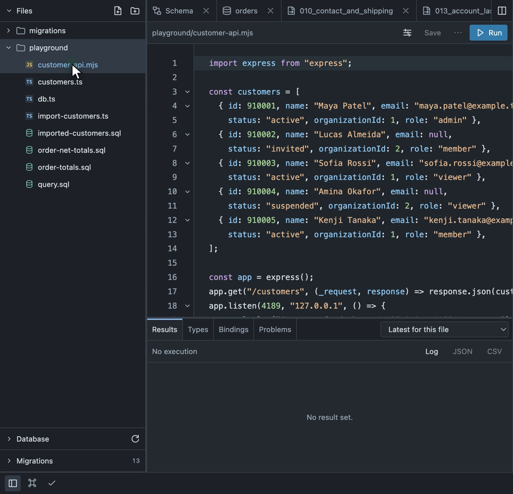
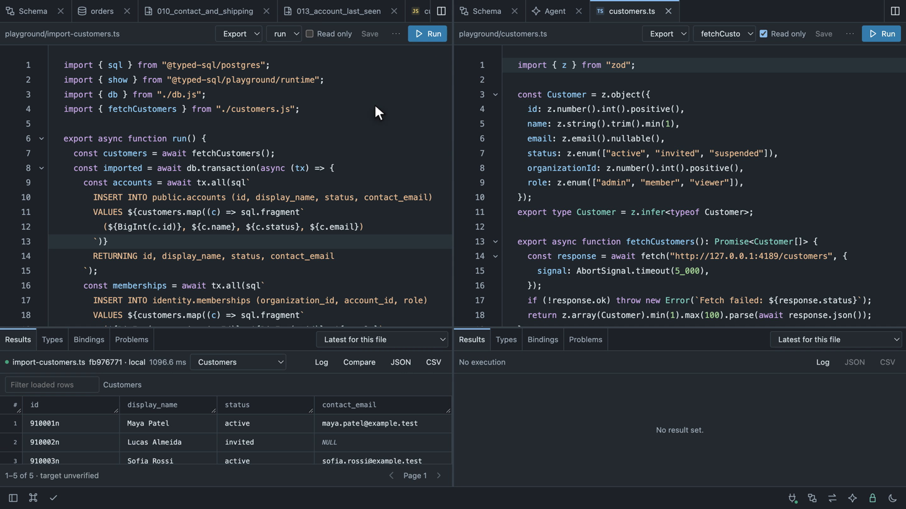
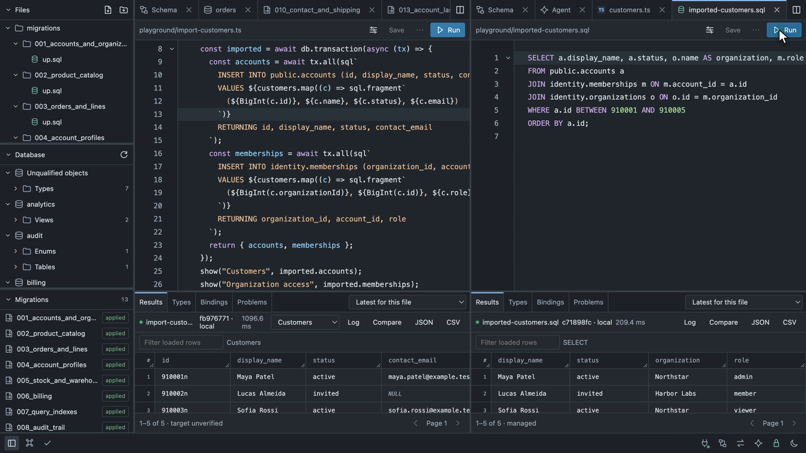

# Workspace tour

Use the local workspace to move between your schema, project files, captured query results and a local agent. This tour follows a commerce project; the screenshots contain synthetic data. The small SQL example below reproduces a query divergence in your own development database.

First [install and connect the workspace](./dev-workspace.md#install-and-launch). Live execution in this tour uses the PostgreSQL adapter. You can explore a saved schema without connecting a target.



## Arrange the workspace

The left explorer has three sections:

- **Files** opens actual project files. Expand folders, create a file with the header button, or right-click a folder or blank area to create files and directories.
- **Database** groups captured tables, views, enums and other objects by namespace. Expand a table to browse its columns, constraints, indexes and relationships.
- **Migrations** shows local migration definitions alongside the selected target's recorded execution state.

Collapse sections you are not using, or drag their dividers to give a long list more room. Use `Cmd/Ctrl+B` to hide the entire explorer while reading code or comparing results. On a small screen it opens as a drawer from the left edge.

Open **Schema** from the bottom bar, then split the editor group right and open **Agent** in the new group. Schema, files, object details, Compare and analysis tabs use the same pane layout. Drag tabs between groups and resize the split to suit the task.

| Action | Shortcut |
| --- | --- |
| Find a file or workspace command | `Cmd/Ctrl+K` |
| Toggle the project explorer | `Cmd/Ctrl+B` |
| Split right / split below | `Cmd/Ctrl+\` / `Cmd/Ctrl+Shift+\` |
| Find text in the focused editor | `Cmd/Ctrl+F` |
| Save / run the active query file | `Cmd/Ctrl+S` / `Cmd/Ctrl+Enter` |
| Format the active file | `Shift+Alt+F` |

## Follow an object and its history

In **Database**, expand a namespace, **Tables**, and a table such as `sales.orders`. Select the table to open its definition. Double-clicking its card on the schema map opens the same page.



The definition shows ordered columns, database types, nullability and key membership. Follow a relationship link to inspect the related object. Indexes and constraints have their own navigable entries. **Capture information** and **Raw captured definition** expand when you need the underlying evidence.

Switch to **History** to inspect recorded changes, then follow **Inspect migration** to the migration that introduced a change. You can also open an applied or pending entry directly from **Migrations**.



A pending migration has a local definition but no recorded application to the selected target. Opening its page does not apply it. Applied history uses recorded attempts and captured before/after evidence; the current SQL file does not prove what ran in the past. Detailed structural history requires `captureDetails: true` when migrations execute. See [migration configuration](./migrations.md) and [workspace history](./dev-workspace.md#explore-and-create-a-query).

## Run two queries and find a difference

This example compares line totals with totals that include adjustments. Apply this minimal fixture through your normal development migration workflow, then regenerate your saved schema and refresh or restart the workspace as described in [connection setup](./dev-workspace.md#connect-postgresql-explicitly). Include `sales` in both the snapshot provider's and workspace target's `schemas` lists.

```sql
CREATE SCHEMA sales;

CREATE TABLE sales.order_lines (
  order_id bigint NOT NULL,
  line_no integer NOT NULL,
  quantity integer NOT NULL,
  unit_price numeric(12, 2) NOT NULL,
  PRIMARY KEY (order_id, line_no)
);

CREATE TABLE sales.line_adjustments (
  order_id bigint NOT NULL,
  line_no integer NOT NULL,
  amount numeric(12, 2) NOT NULL,
  PRIMARY KEY (order_id, line_no),
  FOREIGN KEY (order_id, line_no)
    REFERENCES sales.order_lines (order_id, line_no)
);

INSERT INTO sales.order_lines VALUES (1, 1, 2, 11.00), (2, 1, 3, 8.00);
INSERT INTO sales.line_adjustments VALUES (1, 1, -2.00);
```

The adjustment key allows one adjustment per line in this example. If your real schema allows several, aggregate adjustments per line before joining so the join does not multiply the base amount.

Create `playground/order-totals.sql` from **Files**:

```sql
SELECT l.order_id, SUM(l.quantity * l.unit_price) AS total
FROM sales.order_lines l
GROUP BY l.order_id
ORDER BY l.order_id;
```

Create `playground/order-net-totals.sql`:

```sql
SELECT l.order_id,
       SUM(l.quantity * l.unit_price + COALESCE(a.amount, 0)) AS total
FROM sales.order_lines l
LEFT JOIN sales.line_adjustments a
  ON a.order_id = l.order_id AND a.line_no = l.line_no
GROUP BY l.order_id
ORDER BY l.order_id;
```

Open each file from the tree, inspect its diagnostics, and choose **Run** against the same target. The first query returns totals `22.00` and `24.00`; the second returns `20.00` and `24.00`.

Open **Compare** and select the runs as **Run A** and **Run B**. **Ordered rows** highlights the changed total for order 1 while leaving order 2's matching values neutral. With the larger commerce fixture, the screenshot below shows one changed row and eleven matches.



Compare uses captured results and does not rerun either query. Check completeness and source/target context before drawing conclusions. For queries without a deterministic row order, use unordered multiset comparison. Timing includes different stages of local work; it is not a server execution benchmark. See [comparison semantics](./dev-workspace.md#compare-captured-queries).

## Fetch customers and insert related batches

A TypeScript query can combine an HTTP request with typed SQL and a transaction. This example imports five fictional customers from a small local Express service, then inserts their accounts and organization memberships in two multi-row statements. The input includes active, invited and suspended customers, different roles, and nullable email addresses.

### Serve a local customer feed

Install the application-owned example dependencies:

```sh
pnpm add -D express zod
```

Create `playground/customer-api.mjs`:

```js
import express from "express";

const customers = [
  { id: 910001, name: "Maya Patel", email: "maya.patel@example.test",
    status: "active", organizationId: 1, role: "admin" },
  { id: 910002, name: "Lucas Almeida", email: null,
    status: "invited", organizationId: 2, role: "member" },
  { id: 910003, name: "Sofia Rossi", email: "sofia.rossi@example.test",
    status: "active", organizationId: 1, role: "viewer" },
  { id: 910004, name: "Amina Okafor", email: null,
    status: "suspended", organizationId: 2, role: "viewer" },
  { id: 910005, name: "Kenji Tanaka", email: "kenji.tanaka@example.test",
    status: "active", organizationId: 1, role: "member" },
];

const app = express();
app.get("/customers", (_request, response) => response.json(customers));
app.listen(4189, "127.0.0.1", () => {
  console.log("Customer feed: http://127.0.0.1:4189/customers");
});
```

Run this service in a separate terminal, outside the workspace query runner:

```sh
node playground/customer-api.mjs
```

The service binds to loopback and serves JSON at `http://127.0.0.1:4189/customers`. It performs no database writes. The names and `example.test` email addresses are synthetic.



### Validate the response and infer its type

Create `playground/customers.ts`. The Zod schema trims names, validates email/null values and enum choices, and bounds the batch to 1–100 customers. Its inferred type stays aligned with runtime validation; an HTTP response is not trusted merely because a function declares a return type.

```ts
import { z } from "zod";

const Customer = z.object({
  id: z.number().int().positive(),
  name: z.string().trim().min(1),
  email: z.email().nullable(),
  status: z.enum(["active", "invited", "suspended"]),
  organizationId: z.number().int().positive(),
  role: z.enum(["admin", "member", "viewer"]),
});
export type Customer = z.infer<typeof Customer>;

export async function fetchCustomers(): Promise<Customer[]> {
  const response = await fetch("http://127.0.0.1:4189/customers", {
    signal: AbortSignal.timeout(5_000),
  });
  if (!response.ok) throw new Error(`Fetch failed: ${response.status}`);
  return z.array(Customer).min(1).max(100).parse(await response.json());
}
```

### Insert accounts and memberships atomically

The commerce project already contains the required relations. For the minimal development fixture in this tour, apply the following schema through your migration workflow and regenerate the saved schema. Include both `public` and `identity` in the snapshot provider's and workspace target's `schemas` lists.

```sql
CREATE SCHEMA identity;
CREATE TYPE identity.account_status AS ENUM ('invited', 'active', 'suspended');
CREATE TABLE public.accounts (
  id bigint PRIMARY KEY,
  display_name text NOT NULL,
  status identity.account_status NOT NULL,
  contact_email text
);
CREATE TABLE identity.organizations (
  id bigint PRIMARY KEY,
  name text NOT NULL
);
CREATE TABLE identity.memberships (
  organization_id bigint NOT NULL REFERENCES identity.organizations(id),
  account_id bigint NOT NULL REFERENCES public.accounts(id),
  role text NOT NULL,
  PRIMARY KEY (organization_id, account_id)
);
INSERT INTO identity.organizations VALUES (1, 'Northstar'), (2, 'Harbor Labs');
```

Create `playground/db.ts` to use the selected target's managed database:

```ts
import { databaseForRun } from "@typed-sql/playground/runtime";

export const db = databaseForRun();
```

Then create `playground/import-customers.ts`:

```ts
import { sql } from "@typed-sql/postgres";
import { show } from "@typed-sql/playground/runtime";
import { db } from "./db.js";
import { fetchCustomers } from "./customers.js";

export async function run() {
  const customers = await fetchCustomers();
  const imported = await db.transaction(async (tx) => {
    const accounts = await tx.all(sql`
      INSERT INTO public.accounts (id, display_name, status, contact_email)
      VALUES ${customers.map((c) => sql.fragment`
        (${BigInt(c.id)}, ${c.name}, ${c.status}, ${c.email})
      `)}
      RETURNING id, display_name, status, contact_email
    `);
    const memberships = await tx.all(sql`
      INSERT INTO identity.memberships (organization_id, account_id, role)
      VALUES ${customers.map((c) => sql.fragment`
        (${BigInt(c.organizationId)}, ${BigInt(c.id)}, ${c.role})
      `)}
      RETURNING organization_id, account_id, role
    `);
    return { accounts, memberships };
  });
  show("Customers", imported.accounts);
  show("Organization access", imported.memberships);
}
```

Each direct `Array.map` supplies a fixed SQL row shape; the renderer supplies commas and keeps ordinary values as parameters. Customer IDs become bigint, validated statuses match the database enum, and null emails remain SQL NULL. The second batch links every account to its organization through a composite key. The transaction commits both batches together or rolls them back together; named results are published after it completes.



Enable trusted project execution, select the **run** export, turn off **Read only** for the import file, and choose **Run**. Select **Customers** or **Organization access** in **Result set** to inspect both returned batches. **Types** shows the analyzed SQL contracts. The pictured run inserts five accounts and five memberships. Running the insert again against the same IDs produces a primary-key conflict; use a fresh fixture when repeating it.

Mapped fragments create multi-row SQL statements. They do not imply a native bulk protocol such as PostgreSQL COPY. See [multi-row inserts](../examples/multi-row-insert.md) and [bulk data strategies](./bulk-data.md) for the different execution contracts.

### Query the imported relationships

Create `playground/imported-customers.sql` and run it with **Read only** enabled:

```sql
SELECT a.display_name, a.status, o.name AS organization, m.role
FROM public.accounts a
JOIN identity.memberships m ON m.account_id = a.id
JOIN identity.organizations o ON o.id = m.organization_id
WHERE a.id BETWEEN 910001 AND 910005
ORDER BY a.id;
```



The TypeScript result is labeled **target unverified** because arbitrary TypeScript return values do not prove their database origin. The separate managed SQL readback identifies the selected target. Trust also permits the TypeScript file's own network activity; managed SQL controls do not sandbox `fetch` or other project code. See [trusted project execution](./dev-workspace.md#managed-queries-and-trusted-project-code).

## Ask an agent for an interactive view

[Configure a local ACP agent](./dev-workspace.md#local-agents-and-reviewed-query-tools), such as Codex, and open **Agent** beside your query or comparison. The composer puts the agent profile, permissions and context controls below the prompt. Choose **Ask before use** for approval prompts or **Allow all** for the workspace's available query and inspection tools; file changes still require review.

For the small fixture above, try:

```text
Run playground/order-net-totals.sql and show total by order_id as a bar chart.
Keep the source SQL and captured data available, and state whether the capture is complete.
```

For a project that includes organizations and product categories, try:

```text
Calculate revenue by organization and category. Show a total, a stacked bar chart,
and an organization filter. Include line adjustments without counting line revenue twice.
```

The agent can capture a checked read-only query and publish an interactive analysis card. Expand grouped tool activity when you want the steps. In the card, **Data** exposes retained rows and **Query** exposes the SQL; the chart is another view of that capture.

Use **Open in workspace** to put the analysis in a regular tab. Resize it beside Schema or Compare, apply a filter, and inspect how the displayed rows change. Captured-data filters reuse retained rows; controls marked **Runs query** execute a parameterized refresh when you choose **Apply filters**.

**Export captured data** downloads CSV or lossless JSON. **Export image** offers PNG or SVG. **Save analysis** writes a reusable `.analysis.json` definition inside an allowed project folder. Reopening that definition requires **Run saved analysis** to capture fresh results. See [interactive analyses](./dev-workspace.md#interactive-agent-analyses) for supported charts, limits and persistence.
