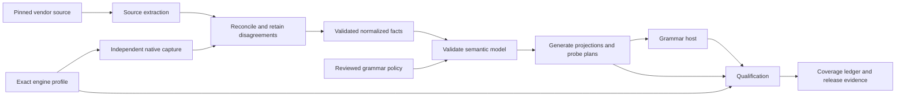

# Generated grammar catalogs and complete engine auditing

Status: preceding design; implementation paused. The final target
[hybrid analysis direction](../hybrid-analysis/spec.md) supersedes universal offline semantic
parity as the product completion requirement. Its research, new acceptance criteria and explicit
disposition of retained work govern the direction change. The material below preserves the
original design and baseline; [the implementation ledger](./implementation.md) retains evidence.

Baseline: `f9b7371581911b20fc46d74b82394d813edb4d0e`, measured on 2026-11-07.

## 1. Outcome and scope

Make upstream engine facts the maintained input for built-ins, vocabulary and type
inventories. Generate the executable tables, indexes, availability checks, probe plans and
coverage reports from a validated intermediate representation (IR). Keep semantic algorithms,
application representation choices and exceptional engine behavior explicit and grammar-owned.

Every declared engine profile must have an auditable account of its functions, overloads,
types, keywords, operators, conversions, syntax productions and other relevant entities.
Missing facts, unsupported behavior and unavailable verification remain visible gaps. A
compilable generated file is not evidence that the represented SQL is supported.

The design serves all five current grammars: PostgreSQL, MySQL, SQLite, SQL Server and DuckDB.
New third-party grammars use the same neutral contracts without implementing a built-in engine
name switch in core. Drivers remain optional application adapters; research and capture tools
may depend on vendor tools in an isolated development workspace.

There are two completion levels:

1. **Catalog foundation:** complete inventory accounting for declared profiles, lossless models
   for available facts, generated projections, independent verification, explicit support gaps,
   and reproducible offline builds. LOC estimates in section 15 refer to this level.
2. **Full grammar parity:** all declared SQL syntax and semantics pass the supported-profile
   qualification requirements, including every supported overload and runtime representation.
   This is the product goal. It requires closing the gaps exposed by the foundation. It is not
   achieved merely by finishing the generator, nor covered by a credible fixed LOC estimate yet.

The foundation must never publish a full-parity claim while known gaps remain. Adding a source
adapter or acknowledging an unsupported entity does not increase semantic support coverage.

## 2. Decisions

| Area | Decision |
| --- | --- |
| Authority | Pinned vendor source plus exact engine observations; official references supplement gaps |
| Shared model | Grammar-neutral structural contracts; grammar-owned meanings and coercion rules |
| Build inputs | Committed normalized facts, provenance, profile manifests, policies and generator |
| Generated executable code | Build output after migration; shipped compiled in npm packages |
| Raw acquisitions | Content-addressed archives with hashes and durable retention; excluded from ordinary build prerequisites |
| Generation | Offline, deterministic and independent of the grammar implementation it emits |
| Refresh | Explicit network/native workflow, separate from build, with a semantic review diff |
| Inference | Unsupported or ambiguous input yields a diagnostic or unknown; never optimistic types or any |
| Qualification | Separate inventory, syntax, binding, nullability and runtime-decoding coverage |
| Loading | Version/profile-specific analysis entrypoints; small query/runtime projections |
| API compatibility | Additive migration first; final root/analyzer separation uses an explicit breaking-release transition |

## 3. Current baseline and constraints

The baseline is reproducible with
`python3 planning/grammar-completeness/measure-loc.py --revision f9b7371581911b20fc46d74b82394d813edb4d0e`.
The captured per-file results are in [loc-baseline.json](./loc-baseline.json).

Counts use physical lines, including comments and blanks. Nonblank counts and bytes are also
recorded. These are not semantic statement counts. JSON formatting, tuple packing or moving
code between directories must not be presented as a reduction in maintained behavior.

The measured scope includes source in the five grammar packages, their tests, seven catalog
policy files, existing generation/audit tools, and two relevant contract tests. It excludes
unrelated packages, dependencies, build output and parallel untracked work. New neutral catalog
mechanics are included in the target estimates even though they move outside those five packages.

| Current category | Files | Physical lines | Bytes | Ownership |
| --- | ---: | ---: | ---: | --- |
| Grammar product TypeScript | 140 | 51,872 | 2,095,902 | Maintained |
| Catalog/policy JSON | 7 | 4,785 | 105,835 | Maintained |
| Generation and audit tools | 21 | 3,213 | 151,535 | Maintained |
| Grammar and selected contract tests | 142 | 35,853 | 1,475,901 | Maintained test code |
| Generated product TypeScript | 26 | 23,672 | 2,579,992 | Generated, currently tracked |
| Captured upstream/combination JSON | 3 | 169,600 | 22,336,716 | Captured, currently tracked |
| Derived generation manifest | 1 | 1,186 | 36,815 | Generated, currently tracked |
| Reference/audit evidence JSON fixtures | 20 | 86,351 | 22,200,406 | Captured/derived evidence with reviewed legacy baseline decisions |
| Existing feature ledger | 1 | 6,282 | 223,820 | Mixed maintained status/evidence declarations |

The first three rows total **59,870 maintained non-test lines**. Including the selected tests,
the total is **95,723**. The feature ledger is tracked separately because its entity/status
records do not map one-to-one to the new ledger; its migration needs a record-level comparison.

Within maintained grammar TypeScript, parser files account for 11,350 lines, catalog wrappers
1,298, resolver/type/codec files 18,715, and other product files 20,509. Database transport,
provider and runtime behavior in the last group is largely outside this refactor.

Current design constraints to remove:

- DuckDB signatures lose parameter names and cannot express table outputs.
- PostgreSQL native signatures reduce results to a type string and lose output-column facts.
- Function-name dispatch remains intertwined with query traversal and typing decisions.
- Type identity, storage identity, modifiers and representation policy are not consistently separate.
- Generation calls a DuckDB parser which imports generated aliases, creating a bootstrap cycle.
- Context sharing compares some raw wire representations rather than normalized facts.
- Some native expectations are normalized through the implementation being tested.
- Dynamic version registries retain every version's analysis catalog.
- Syntax/keyword/type accounting and actual native semantic verification have different strengths.

Schema V2 already models named/default arguments and scalar/set/record/table results. Reuse its
concepts and adapters. Do not force raw polymorphic built-ins into pre-bound application schema
types, or duplicate application snapshot envelopes to make code generation convenient.

## 4. End repository topology

`M` means maintained; `N` means generated normalized facts committed as build inputs; `G` means
generated build output; `E` means captured evidence outside the ordinary source build.
Angle-bracket paths are layout patterns, not promised literal filenames.

```text
grammar/
  catalog/
    format.schema.json                         M: versioned interchange envelope
    profiles.json                              M: declared supported/qualification targets
    objects/<sha256>.jsonl                      N: normalized, content-addressed fact chunks
    evidence/<profile-id>.json                  N: provenance and qualification artifact references
  <dialect>/
    sources.lock.json                          M: exact source revisions and acquisition digests
    profiles/<profile-id>.json                  M: build/mode/extension/compatibility conditions
    facts/<profile-id>.json                     N: roots of that profile's fact graph
    policy/
      representation.json                      M: native type to application policy selections
      semantics.json                           M: explicit semantic rule bindings/parameters
      exceptions.json                          M: justified source/engine differences and evidence
    qualification.json                         M: required proof dimensions and approved scope
  features/ledger.json                          transitional input; removed after lossless migration

tools/grammar-catalog/                         M: private development workspace; never a runtime dependency
  package.json
  src/
    model/                                     neutral IR, schema validation, canonicalization
    provenance/                                source locks, hashes, evidence validation
    sources/<dialect>/                         vendor source extraction adapters
    capture/<dialect>/                         native inventories and independent descriptions
    reconcile/                                 source disagreements, context and version differences
    generate/                                  projections, typed emitters, public export maps
    probes/                                    invocation plans, witnesses, negative cases
    qualify/                                   coverage algebra and qualification decisions
    commands/                                  refresh, normalize, diff, generate, check, qualify, report
  fixtures/                                    M: small licensed source/extraction regression examples
  test/                                        M: model, extraction and reconciliation tests

packages/core/src/catalog/                     M: small neutral runtime/analysis contracts and mechanics
  identity.ts                                  logical identity and structured type references
  signatures.ts                                structural signature/type-expression contracts
  profile.ts                                   availability and qualified-profile contracts
  match.ts                                     argument binding mechanics; grammar callbacks own meaning
  evidence.ts                                  projection/revision validation contracts

packages/<dialect>/src/
  index.ts                                     M: final lightweight root query-facing exports
  query.ts                                     M: query tags and value-plan helpers
  runtime.ts                                   M: runtime surface with small codec/profile projections
  analysis/
    index.ts                                   M: explicit async profile loader
    create.ts                                  M: construct synchronous plugin from a loaded catalog
    binding.ts                                 M: grammar-owned overload/coercion behavior
    rules/                                     M: reusable semantic rule implementations
    generated/<profile-or-band>/               G: typed signatures, types, operators, casts, indexes
    generated/loaders.ts                        G: explicit dynamic-import map, no eager all-version imports
  parser/
    parser.ts                                  M: parser/AST integration until individually replaced
    tokenizer.ts                               M: scanning mechanics and contextual interpretation
    generated/vocabulary.ts                    G: keyword/token facts and version conditions
  codecs/
    rules.ts                                   M: grammar/driver representation decisions
    generated/<policy-family>.ts               G: small codec/type recognition projection
  compatibility/legacy-analysis.ts              M: transitional eager API implementation
  test/
    rules/                                     M: semantic, nullability and codec regression witnesses
    catalog-conformance.test.ts                M: generic assertions over generated data/probe plans

packages/conformance/src/catalog/              M: neutral assertions and evidence result contracts
e2e/grammar-catalog/<dialect>/                  M: native qualification runners and isolated fixtures
test/contracts/grammar-catalog.test.ts          M: package, provenance, loading and offline-build contracts

scripts/catalog.mjs                            M: thin command dispatcher
scripts/catalog-generation/                    removed after parity with replacement is proven
scripts/language-audit/                        removed after audit/report compatibility is proven

artifacts/grammar-catalog/                      ignored, E/G
  acquisitions/<sha256>/                        E: raw archives and native capture envelopes
  qualified/<profile-id>/                       E: full results and immutable run manifests
  reports/                                     G: HTML/JSON/Markdown coverage and semantic diffs
  benchmarks/                                  E: bundled/unbundled import and startup measurements

planning/grammar-completeness/                  M: implementation specification and migration evidence
docs/reference/grammar-coverage.md              durable public explanation and generated coverage tables
```

Normalized facts and emitted code are generated, but the former are reviewable build inputs and
the latter are disposable outputs. CI re-extracts/reconciles inputs in refresh/qualification
jobs; a normal build validates and consumes the committed inputs without rediscovering SQL.

No new published engine-catalog package is required. The private tool workspace depends on
neutral build-time models. Runtime contracts in core must not import the private tools, source
archives, engine drivers, or experimental TypeScript integrations. Grammar packages continue to
own their interpretation of the model. New core exports require normal public API review and a
Changeset; a stable package cannot depend on an unpublished private workspace.

The topology is the final state, not a request to rename every source file in one PR. Existing
runtime filenames and public adapters may remain where moving them has no architectural value.

### 4.1 Current-to-target ownership map

| Current location | Target ownership | Removal condition |
| --- | --- | --- |
| `grammar/catalog/upstream.json` | Normalized object graph plus provenance/evidence manifests | Every row, source query, profile and unknown represented or explicitly archived |
| `grammar/*/catalog/core.json` and `policy.json` | Native declarations become facts; human choices become small policy bindings | Field-level migration report; no behavior silently reclassified as upstream fact |
| DuckDB `combinations-*.json` | Profile-specific observed derivation facts with native oracle revision | All accepted/rejected pairs and contexts retained and independently regenerated |
| `packages/*/src/catalog/generated/` | Disposable analysis/runtime/vocabulary projections | Clean offline build and package tarball checks pass |
| Parser `vocabulary.generated.ts` | Generated vocabulary projection | Case/context/version regression witnesses pass |
| Resolver function/type name switches | Generated bindings plus reusable grammar-owned rule implementations | Native agreement and ambiguity/nullability regressions pass |
| `test/fixtures/language-audit/*.json` | Fact/evidence graph, explicit exceptions and regression witnesses | No legacy discovery or reviewed discrepancy disappears |
| Existing audit/generation scripts | Private catalog tool workspace and thin dispatchers | Equivalent commands/reports and required native lanes verified |
| Existing feature ledger | Generated coverage ledger with separately maintained scope/exception declarations | Record-level migration proves all current claims and gaps remain visible |

Keep a machine-readable migration map listing old field/path, new entity/field, transformation,
ownership and evidence. A move to generated output must identify which upstream fact supplies
the value. A move to policy must identify who maintains the decision. Unmapped data blocks deletion.

## 5. Acquisition, normalization and reconciliation

The pipeline is:



Each acquired object records engine family, source revision, exact build or image digest,
acquisition method, extractor version, content digest, relevant license/notice reference and
profile conditions. Record timestamps as evidence metadata, excluded from semantic content
hashes. Retain original values for forensic inspection; never retain secrets or credentials.

Parse structured vendor files with grammar/preprocessor-aware extraction where necessary.
Prefer generated vendor registries or instrumented vendor builds over regexes across C/C++.
HTML remains a fallback discovery signal. Source adapters have versioned supported formats,
small extraction fixtures, and explicit errors for an unfamiliar upstream structure.

Normalize known wire encodings before equality comparison: integers/booleans, nulls, ordered
arguments, names under the dialect's rules and source-specific type references. Do not coerce an
unrecognized string into a valid numeric field. Preserve profile differences. Identical facts
can share a content-addressed chunk; differing facts remain available behind explicit conditions.
Do not build the common catalog by silently discarding the intersection's excluded rows.

Reconciliation emits one of: agreed, complementary, conflicting, source-only or engine-only.
Conflicts fail promotion until resolved by corrected extraction, a narrower profile or an
evidence-backed exception. A source-only item can be real but disabled in this build; an
engine-only item can come from an extension. Neither case is automatically a missing built-in.

Exceptions specify entity, affected profiles, expected discrepancy, rationale, evidence and
revalidation condition. They cannot change an observed wrong type into a passing match or
remove unsupported entries from the coverage denominator. Avoid a generic accept-current-output
baseline command for semantic disagreements.

## 6. Per-engine source contracts

| Grammar | Syntax and vocabulary | Signatures/types | Independent binding evidence | Conditions to preserve |
| --- | --- | --- | --- | --- |
| PostgreSQL | `kwlist.h`, scanner and `gram.y` from pinned source | Catalog `.dat`/`.h` plus exact `pg_proc`, `pg_type`, `pg_operator`, `pg_cast`, `pg_aggregate` captures | Native Parse/Describe; version-pinned parser oracle as an additional syntax check | Release/build, extensions, search path, type identities |
| MySQL | `lex.h`, `sql_yacc.yy`, generated keyword facts | Function factory registrations, typed Item/binding source, native type metadata | Prepared metadata and parameterized fixtures | Release, SQL modes, character sets/collations, enabled components |
| SQLite | `parse.y`, keyword generator, exact amalgamation/source ID | Built-in registration tables, `function_list`, type/affinity/STRICT rules | Prepared statements plus isolated runtime storage-class fixtures | Compile options, wrapper/build, loaded modules/extensions |
| SQL Server | Versioned ScriptDOM grammar/token/AST sources; official reference source | `sys.types`, documented signatures and reviewed binder-rule overlay | Native first-result-set and undeclared-parameter description | Server build, compatibility level, settings, collation, enabled features |
| DuckDB | Pinned parser/token source and native keyword metadata | Native functions/types/casts plus function registrations and structured upstream metadata | Native bind/describe and argument-dependent table-schema witnesses | Engine build, loaded extensions, settings, external-schema inputs |

PostgreSQL catalog bootstrap files must be expanded with their header defaults and vendor
generation rules. `pg_cast` does not enumerate conversions supplied by generic rules. Strict
functions can still return null for non-null arguments; strictness alone cannot prove non-null.

DuckDB documentation JSON provides names/aliases and documentation parameter names, not a
complete formal overload model. Native capture and binding logic supply additional facts.
Argument-dependent table schemas are modeled as schema functions with required inputs; an
unknown external schema remains a gap rather than a guessed row shape.

MySQL ordinary function registries do not include every parser-special invocation. Source
extraction covers both. Routine metadata for stored routines is not treated as the builtin
inventory. Numeric wire type codes must be decoded independently of typed-sql's own type parser.

SQLite has dynamic values and affinity rules. It does not gain universal fixed return types
because it has a generated signature table. Build-dependent inventories are separate profiles;
wrapper differences must not erase shared facts through mismatched JSON wire types.

SQL Server's public parser is not a semantic binder or a universal built-in overload catalog.
The overlay remains explicit and independently validated. Logical type identity must include
feature-specific information; internal storage ID equality is insufficient to establish aliases.

Source license/notice metadata accompanies every adapter and fixture. Review extraction and
redistribution choices before vendoring parser implementations or vendor code; source facts and
copied implementation code are tracked separately. Do not ship vendor development toolchains in
runtime packages.

## 7. Intermediate representation

The IR is a versioned, validated interchange model with stable entity IDs and explicit unknowns.
No generator consumes arbitrary raw driver rows. The exact TypeScript API is an implementation
detail until the model pilot passes; the required information is specified here.

### 7.1 Identity, type expressions and provenance

An entity has dialect, namespace, canonical identity, source spellings, aliases, entity kind,
availability predicate and evidence references. Routine identities include overload information,
not just a lowercased name. OIDs and vendor IDs are scoped to the captured profile rather than
treated as globally stable cross-version names.

Type expressions support concrete logical references, type variables, arrays, domains,
parameterized types, rows, unions/alternatives and opaque/unknown forms. Variables reference
constraints and unification rules rather than the wildcard string `ANY`. Distinguish type
families from engine types literally named `ANY` or `UNKNOWN`.

Keep separate fields for logical identity, physical storage, wire identity, accepted SQL
spellings, modifiers and application representation. Aliases require explicit evidence and
availability, never just matching widths/storage IDs. Modifiers retain whether specified,
defaulted, inferred or unknown. Context-specific defaults distinguish declarations, casts,
conversions and other grammar contexts.

### 7.2 Routines

Each overload records:

- Routine kind: scalar, aggregate, window, set-returning, table, macro or procedure.
- Formal arguments in order, with name, input/output mode and type expression.
- Default state: absent, present with known expression, present but expression unavailable, unknown.
- Named-argument acceptance, positional/named mixing restrictions and variadic expansion rules.
- Scalar, set, fixed-row, table-schema-function, void or command result.
- Generic constraints, type/result transfer rules and value-dependent result inputs.
- Null-input behavior separately from the result-nullability transfer rule.
- Volatility, side effects, exception behavior where evidenced, and safe probe classification.
- Invocation syntax: ordinary call or a grammar production, such as CAST or special EXTRACT syntax.
- Required window/ordering/filter clauses and availability conditions.

Every omitted source field is accounted for as intentionally audit-only, not applicable,
unknown, or consumed by a named projection. Emit a projection-loss report. A newly available
semantic field cannot silently disappear into an old tuple representation.

### 7.3 Other entities

| Category | Required model |
| --- | --- |
| Keywords/tokens | Token ID, canonical spelling, case rules, reserved/contextual classes, identifier positions and conditions |
| Types | Logical identity, parameters/default contexts, categories, domains, arrays, enums, literal/binding behavior and representation references |
| Operators | Token/form, arity, precedence/associativity where available, overloads and semantic rule references |
| Casts/coercions | Source/target constraints, explicit/assignment/implicit context, generic derivations and modifier behavior |
| Syntax | Source production IDs, alternatives and conditions, AST mapping/status and positive/negative witnesses |
| Collations | Inventory, identity, availability and semantic support status; enumeration is not collation emulation |
| Settings/pragmas | Name, arguments/value domain, effects on parsing/binding/runtime, and captured profile value |
| Extensions/modules | Available versus installed versus loaded, contributed entities, version and trust/provenance |

`SELECT`, `select` and mixed case share one canonical keyword identity. Tests cover the
variants. Quoted identifiers, collation-dependent identifiers and routine name matching keep
their dialect-specific rules; there is no global lowercase-all normalization.

### 7.4 Availability and profile selection

Predicates can reference engine version/build, compatibility level, SQL mode, compile option,
feature and extension versions. Evaluation is total: true, false or unresolved. Unresolved
availability cannot grant support. Profiles declare all required observations and their origin.

Do not merge every engine context into a single universal catalog or multiply every independent
setting into an impossible Cartesian test matrix. Define which conditions affect each entity
and qualify the relevant boundaries/interactions. Pairwise tests are useful additional evidence,
not proof of every combination. Record which combinations were actually qualified.

A supported range and an exact tested release remain distinct. A range may share rules when
justified; the report always lists exact captures. An unseen build cannot inherit a claim of
exact native verification. Unsupported/new semantic conditions fail closed and trigger review.

## 8. Host integration and generated projections

Separate query traversal, argument mechanics, grammar semantics and database representation.
The host consumes a catalog interface rather than scanning a function-name switch.

Neutral mechanics may bind argument positions/names/defaults, evaluate structural availability,
index identities and record evidence. Grammar callbacks own overload ranking, implicit coercion,
type preference, numeric precision, nullability, special syntax and diagnostics. Keep core free
of PostgreSQL/MySQL/SQLite/SQL Server/DuckDB special cases.

Grammar-owned rule implementations should cover reusable families: fixed result, argument
preservation, common type, numeric widening, polymorphic container, aggregate/window behavior,
nullable-on-condition and table-schema computation. Their actual semantics vary by grammar;
sharing an implementation requires conformance evidence, not a similarly named SQL function.
Bindings and declarative parameters can be generated. New behavior requires an implemented,
reviewed rule. Avoid creating an unrestricted second programming language in policy JSON.

Generate separate projections:

| Projection | Contents | Consumer |
| --- | --- | --- |
| Analysis | Full binding signatures, type relationships, operators and semantic rule references | Compiler and language server |
| Vocabulary | Tokens/classes/version conditions required by parsing | Grammar tokenizer/parser |
| Runtime | Codec recognition and target compatibility facts only | Application runtime/adapters |
| Probe plans | Formal invocation classes and evidence requirements | Native qualification runner |
| Reporting | Complete inventory, gaps, provenance and coverage | Maintainers and public coverage summaries |

Analysis and runtime projections use the same type policy revision and logical identities.
Projection manifests include model, generator and policy digests. Mismatched runtime/compiler
revisions produce a clear compatibility failure. No `as unknown as` escape may substitute for
validating the generated shape. Prefer typed emitters and `satisfies`/checked annotations.

The parser is not automatically replaced by the new catalog. Extracting syntax productions
creates a coverage denominator and test inputs; it does not make our parser implement them.
Keep AST mapping, source-span preservation and grammar-specific diagnostics explicit. Consider
vendor-parser bridges or generated parser replacement per grammar after pilots establish
licensing, portability, performance and AST fidelity. A blanket switch to a community grammar
does not satisfy vendor parity.

## 9. Loading and public API transition

The current root exports synchronously reference analyzer implementations. In native ESM,
keeping those imports while claiming that root imports no longer load their catalogs would be
incorrect. `sideEffects: false` only helps capable bundlers.

Final loading topology:

- `@typed-sql/<dialect>` remains the application import for `sql` and lightweight query helpers.
- `@typed-sql/<dialect>/runtime` and explicit driver adapters load only the runtime projection.
- `@typed-sql/<dialect>/analysis/<band>` synchronously exposes a plugin bound to that band's data.
- `@typed-sql/<dialect>/analysis` selects and asynchronously loads a qualified catalog before
  returning a plugin. Once constructed, `DialectPlugin.analyze` remains synchronous.
- A generated loader map lists explicit import paths. It must not statically import every
  catalog, and selection cannot use a bundler-opaque arbitrary path expression.

Illustrative final imports:

```ts
// Application code, unchanged in principle.
import { sql } from "@typed-sql/postgres";

// Build/editor configuration selecting an explicit analysis band.
import { postgres } from "@typed-sql/postgres/analysis/18";

// Alternatively, initialization loads the requested catalog before analysis starts.
import { loadPostgres } from "@typed-sql/postgres/analysis";
const dialect = await loadPostgres({ profile: "postgres-18-core" });
```

Names are proposed API spellings; finalize them with the API contract review. A band entrypoint
can contain conditional profile deltas, but must not import unrelated bands. Snapshot evidence
is checked against the selected catalog; disagreement is diagnostic, not a fallback to another
version. Drivers do not choose or download analysis modules at application runtime.

First add analysis entrypoints while preserving existing root factories. During that stage,
unbundled legacy root imports retain their existing cost. Move root analysis factories and
analysis-heavy helpers to an explicit compatibility entrypoint in the breaking release; provide
documented import migrations. Do not silently make an existing synchronous factory asynchronous.

CLI/config/editor setup must load the plugin before the synchronous analysis phase. Verify
async configuration support or introduce an explicit preparation step. TS bridge/LS changes
stay isolated; stable core does not import preview-backed packages. Third-party grammar
fixtures and packed consumers must exercise both explicit and prepared plugin construction.

## 10. Independent live auditing

Two independently assembled inputs drive qualification:

1. The normalized source/engine inventory determines the full scope to account for.
2. Fresh native discovery and independent engine/parser oracles detect extraction and host gaps.

Generated tables must not define the only denominator, and generated probes must not define
the only test oracle. A skipped extraction row or emitted signature must remain detectable by
the inventory reconciliation. Retain hand-maintained regression witnesses and disagreement
cases alongside automatically generated cases.

Required verification by category:

| Category | Generated checks | Native/reference checks |
| --- | --- | --- |
| Keywords | Case variants, quoted/contextual identifier positions, token classifications | Compiled keyword API or vendor parser plus engine syntax witnesses |
| Types | Spellings, modifiers, omitted defaults, arrays/domains, declaration/cast contexts | Native logical identity and modifiers; runtime decoding witnesses |
| Functions | Overload/arity boundaries, defaults, named arguments, variadics, generic families, null/non-null cases | Prepare/bind/describe; safe value fixtures for nullability and value-dependent behavior |
| Operators | Unary/binary forms, precedence examples, concrete/generic signatures | Native binding/results and negative cases |
| Casts | Explicit/assignment/implicit contexts and generic derivations | Engine acceptance/result types and modifier behavior |
| Syntax | Production/alternative witnesses, invalid neighbors and nesting combinations | Version-pinned parser and actual engine where possible |
| Other | Inventory drift, argument/value domains and availability | Native metadata; behavior checks for product-supported effects |

Routine probe expansion must cover formal default-omission boundaries, named/positional
restrictions and variadic element forms. A zero-to-five-NULL-argument loop is not sufficient.
Use typed parameters to avoid constant folding where possible. Large generic spaces require
constraint-class partitions, boundary witnesses and recorded uncovered dimensions; do not
claim an untested infinite input domain was enumerated.

Native expected types use independent vendor IDs, logical metadata and modifier decoding.
Do not pass expected values through typed-sql's generated aliases or type parser. Comparison
can map into a separate documented oracle schema, with its own fixtures. The vector and bare
VARCHAR cast cases must be permanent regression witnesses.

Nullability requires dedicated evidence: strictness, a successful NULL call or one non-null
result does not establish the complete transfer rule. Verify ordered parameters, inferred row
types, diagnostics and source spans together in grammar-owned tests.

Prepare/describe and runtime-value verification are different evidence classes. Never execute
every discovered function automatically: some have effects, are privileged, access files or
depend on the environment. Native compilation itself may have effects, including some SQLite
PRAGMAs. Use disposable databases/processes, constrained credentials, deadlines, and explicitly
classified fixtures. Unavailable safe verification remains visible.

Native matrix requirements derive from declared qualification profiles, not a second manual
workflow list. Every required job publishes a completion manifest. Missing/skipped/cancelled
jobs fail the aggregate gate. Experimental future profiles may be non-blocking, but cannot
contribute qualified support to stable coverage.

## 11. Coverage algebra and qualification

Maintain a stable entry for every discovered entity/overload/production in every applicable
profile. Each entry has independent fields for discovery, representation, syntax, binding,
nullability and decoding. State values include supported, unsupported, unverified, conflicting,
blocked and not-applicable with a justified applicability rule.

For each dimension report `verified / applicable`, plus unsupported, unverified, conflicting
and excluded counts. Do not collapse them into a single percentage. Count overloads as well as
function names, production alternatives as well as token names, and profiles separately.
An empty denominator yields not-applicable or missing inventory, never 100% by arithmetic.

Report at least:

- Upstream inventory accounting: entities reconciled / discovered entities.
- Model fidelity: required semantic fields represented / required fields available upstream.
- Parser coverage: supported productions/alternatives and witnessed conditions.
- Binding coverage: applicable overload/constraint cases supported and independently checked.
- Type/nullability/decoder agreement: comparable claims with matching independent evidence.
- Verification availability: which claims have no usable oracle and why.

Generated code compilation and structural validation are necessary gates; they are not semantic
coverage. Conservative unknown inference preserves soundness but counts as a support gap.
Inventory-only collations/settings remain inventory-only until their supported effects are
implemented. Explicitly unsupported engine internals remain in the report; any product-scope
exclusion is reviewed and shown in the claim, never hidden in a denominator filter.

Qualification artifacts include engine/profile/source/model/policy/generator revisions, native
runner/toolchain versions, complete counts, failure witnesses and run completion status. The
coverage entry references immutable evidence. An unavailable or expired artifact reference
cannot substantiate a current claim; define retention and retrieval checks in CI.

The foundation gate requires no unaccounted entities and no unexplained projection loss or
conflicts. Full parity additionally requires zero unsupported/unverified applicable behavior
in the declared scope. Finite test coverage does not mathematically prove all possible SQL;
the report states the evidence and scope rather than asserting that nothing can ever be missed.

## 12. Build, refresh and publication commands

Proposed consolidated interface:

```sh
pnpm catalog:refresh --profile <id>      # explicit acquisition/native access; writes candidate facts
pnpm catalog:diff                       # reviewable entity/field/profile changes
pnpm catalog:normalize                  # canonical validated committed fact objects
pnpm catalog:generate                   # offline executable projections and manifests
pnpm catalog:check                      # offline integrity + deterministic regeneration check
pnpm catalog:qualify --profile <id>      # independent native evidence and coverage result
pnpm catalog:report                     # ledger and public-summary generation
```

Command names are maintainer contracts documented in the tool README. Replace overlapping
PostgreSQL/MySQL-specific and language-audit commands with forwarding aliases during migration.
Remove aliases only after workflows, documentation and downstream automation are updated.

Build/typecheck entrypoints must generate before TypeScript resolves emitted imports. Both
`pnpm build` and direct `pnpm typecheck` work after generated files are deleted. Generation
uses an independently bootstrappable tool runner and reads no grammar runtime imports.
`catalog:check` must work with missing outputs and compare temporary regenerated output against
the expected digests; absence of disposable output is not stale committed source.

Generated directories are ignored only after clean-build proof passes. Emission is atomic,
sort-stable, path-independent and free of timestamps/random IDs. A no-op regeneration produces
identical bytes. Deleting an input cannot leave stale output or export-map entries behind.

Pack/publish consumes build output and rejects missing catalog artifacts or incompatible
revision manifests. Consumers receive compiled JS and declarations, not a postinstall generator
or a database dependency. Preserve normal package-boundary, forbidden-driver, public API,
release-manifest and preview-isolation contracts.

Refreshing new facts cannot automatically qualify or promote a profile. A semantic difference
requires policy/host support and new evidence. Failed qualification preserves the last qualified
input/release rather than overwriting it with a green-looking partial report.

## 13. Bundle and runtime acceptance

The research baseline uses minified ESM with esbuild 0.28.2 targeting Node 22. Ordinary root sql
tag consumers retain zero generated analysis-catalog bytes and total roughly 17 KiB. This
behavior must remain true during migration.

| Analyzer consumer | Current minified KiB | Current gzip KiB |
| --- | ---: | ---: |
| PostgreSQL | 1,649.2 | 134.1 |
| MySQL | 172.4 | 41.9 |
| SQLite | 154.7 | 39.5 |
| SQL Server | 138.5 | 35.7 |
| DuckDB | 682.1 | 83.1 |

Native Node 24 root imports load 2,095,068 generated source bytes for PostgreSQL and 680,819 for
DuckDB. These are source-loading measurements, not memory or startup benchmarks. PostgreSQL
analyzer currently retains six major catalogs; DuckDB retains both bands and pair matrices.

Acceptance requires:

- Packed query and runtime consumers import no heavy analysis projections.
- Final lightweight root native-ESM imports load zero analysis-catalog modules after the
  breaking API transition. Small vocabulary/codec projections are measured separately.
- A specific analysis-band entrypoint imports zero unrelated bands.
- Generic asynchronous loading imports only the selected band and relevant profile deltas.
- Named query-tag bundled size stays within 5% of the same-tool baseline unless a separately
  justified product change is approved; added catalog facts do not justify query bundle growth.
- esbuild and Rollup or webpack consumer fixtures validate actual published exports. Browser,
  Node and worker packaging are checked where the package claims support.
- Cold module import, catalog initialization, peak/retained memory and warm analysis latency
  are measured separately with repeated runs on declared CI classes.

Do not set an arbitrary promised analyzer byte reduction before the compact-layout pilot.
Record per-version and all-version bytes, logical record counts and performance together.
Additional supported semantics may grow the selected catalog even while unrelated-version
loading disappears. Existing performance budgets remain binding; changing them needs measured
evidence and a separate justification.

## 14. What remains maintained

| Maintained responsibility | Why generation cannot replace it by enumeration alone |
| --- | --- |
| Vendor source adapters | Source layouts and registrations differ across engines/releases |
| Grammar semantics | Generic coercion, ranking and nullability are algorithms, not name lists |
| Representation policy/codecs | Database logical types do not choose the application's JS policy |
| Parser/AST integration | Knowing a production exists does not implement or map it |
| Dynamic/schema-dependent behavior | Results may depend on arguments, schema, extensions or runtime data |
| Independent oracles and witnesses | Generated output cannot certify its own correctness |
| Reviewed exceptions | Public metadata is incomplete or inconsistent for some features |
| Driver/runtime plumbing | Transport, streaming, providers and decoding execution remain product code |

Generated responsibilities include catalog indexes, concrete overload declarations, evidenced
aliases, token inventories, profile membership, declarative rule bindings, codec dispatch
tables, probe expansion plans, coverage aggregation and reports. Rule implementations are not
generated from successful examples or inferred by an LLM during release builds.

## 15. LOC and artifact projections

These are engineering estimates for the **catalog foundation on the current target breadth**,
not measured outcomes or a full-parity implementation quote. Ranges include rewritten rules,
the new neutral kernel and stronger tooling; they do not assume that all existing resolver or
parser lines disappear. Re-estimate after the PostgreSQL and SQL Server pilots.

### 15.1 Maintained grammar product TypeScript

| Component | Current | Expected | Expected delta |
| --- | ---: | ---: | ---: |
| PostgreSQL | 17,770 | 14,500–16,000 | −3,270 to −1,770 |
| MySQL | 9,893 | 8,000–9,000 | −1,893 to −893 |
| SQLite | 7,461 | 6,000–7,000 | −1,461 to −461 |
| SQL Server | 9,093 | 8,000–9,000 | −1,093 to −93 |
| DuckDB | 7,655 | 5,500–6,500 | −2,155 to −1,155 |
| New neutral catalog mechanics in core | 0 | 2,000–3,000 | +2,000 to +3,000 |
| **Total** | **51,872** | **44,000–50,500** | **−7,872 to −1,372** |

That is roughly **3–15% less maintained product TypeScript**, including relocated neutral
mechanics. The five grammar directories alone fall to 42,000–47,500 lines; reporting only that
reduction would hide the new shared code. These ranges assume query traversal and most parser
mechanics remain. The largest savings should come from repetitive resolver cases, catalog
declarations, type recognition and availability logic, not database transport.

The corresponding area budget makes the assumptions inspectable:

| Area in existing grammar packages | Current | Expected | Reason |
| --- | ---: | ---: | --- |
| Parser/scanner/AST files | 11,350 | 10,000–11,350 | Small token/context simplification; no assumed wholesale parser replacement |
| Catalog wrappers/mechanics | 1,298 | 700–1,200 | Thin indexes/interfaces over generated projections |
| Resolver/type/codec files | 18,715 | 11,500–14,500 | Remove repeated declarations/dispatch; preserve grammar semantic algorithms |
| Other product files | 20,509 | 19,800–20,450 | Mostly unchanged transport/provider/runtime behavior |
| Existing grammar-package subtotal | 51,872 | 42,000–47,500 | New neutral core mechanics counted separately above |

These are budgets to test in pilots, not a line-by-line deletion finding. If code inspection
shows that a proposed saving is already generated or is necessary independent behavior, revise
the estimate instead of forcing the implementation to meet a cosmetic LOC target.

### 15.2 Maintained policies, tooling and tests

| Category | Current | Expected | Expected delta |
| --- | ---: | ---: | ---: |
| Maintained product TS including new neutral mechanics | 51,872 | 44,000–50,500 | −7,872 to −1,372 |
| Maintained policy/overlay JSON | 4,785 | 2,500–4,500 | −2,285 to −285 |
| New maintained source/profile/qualification declarations | 0 separately counted | 1,000–2,000 | +1,000 to +2,000 |
| Maintained extraction/generation/audit tools | 3,213 | 8,000–12,000 | +4,787 to +8,787 |
| **Maintained non-test total** | **59,870** | **55,500–69,000** | **−4,370 to +9,130** |
| Maintained tests, including new tooling/conformance tests | 35,853 | 43,000–55,000 | +7,147 to +19,147 |
| **Maintained total including tests** | **95,723** | **98,500–124,000** | **+2,777 to +28,277** |

The midpoint planning scenario is 62,250 maintained non-test lines, approximately **+2,380** over
the current scope. That reflects replacing repeated product declarations with stronger shared
infrastructure. A smaller grammar host does not imply a smaller repository or fewer tests.
Policy savings are less certain for SQL Server/MySQL/SQLite because upstream formal metadata is
incomplete. If policies merely move to a new directory, report a zero reduction for that move.
Current profile/source selections are embedded in tooling and reference envelopes rather than
a separately maintained declaration category; the new explicit manifests are counted as added
maintenance. The 6,282-line mixed feature ledger remains outside both totals until its maintained
decisions and generated records can be separated; do not claim its removal as a manual LOC saving.

Tooling includes the maintained model/provenance machinery, five source/native adapters,
reconciliation, emitters, probe planning, reporting and command integration. The range excludes
vendored third-party implementations, which must be counted separately if a pilot adopts one.

### 15.3 Generated/captured output

| Category | Current | Expected foundation state | Treatment |
| --- | --- | --- | --- |
| Generated product TS | 23,672 lines / 2.58 MB, tracked | Provisional 35,000–90,000 lines / 3–8 MB in the working build | Generated and shipped compiled; 0 committed executable lines after migration |
| Normalized/captured facts and legacy reference evidence | 255,951 JSON lines / 44.54 MB combined | Provisional 25–60 MB of normalized chunks and evidence manifests; low confidence | Deduplicate repeated inventories; commit required normalized inputs; count bytes/entities, not JSONL lines |
| Raw source/native acquisitions | Mixed current upstream corpus | Potentially large, depends on vendor artifacts and retention | Archived evidence, not runtime or required offline-build downloads |
| Probe/test cases | Mostly generated at test runtime | Expanded automatically from signatures/constraints | Store compact plans/witnesses, not one committed TS test per generated case |
| Coverage reports | Derived manifest and planning reports | Full per-profile/per-category status and semantic diffs | Generated evidence; public summaries derive from qualified claims |

Generated output ranges have **low confidence** until all source adapters have complete
signatures. Physical lines depend heavily on formatting; compare bytes, entity/overload counts
and useful support alongside LOC. Do not minify data solely to claim a LOC reduction. The
generated working tree and npm tarballs may grow while maintained product code shrinks.
Retiring legacy reference JSON requires preserving its discoveries, regressions and reviewed
decisions in the new fact graph, explicit exceptions and independent witness suite. Raw archival
evidence is additional to the normalized-input size projection.

Removing tracked emitted TS subtracts 23,672 current repository lines, but **saves zero manual
maintenance lines by itself**. Normalized facts remain generated data in version control. Raw
data must not be removed from archival retention simply to make repository statistics smaller.

### 15.4 Full-parity scope beyond these estimates

The inventory foundation will expose parser productions, table functions, special syntax,
coercion families and runtime behavior not currently implemented. Closing those gaps may add
substantial maintained and generated code. SQL Server source constraints and SQLite dynamic
semantics make a universal automatic code-emission percentage especially misleading.

Before estimating full-parity LOC, produce a per-engine backlog grouped by missing production,
semantic rule, representation rule and oracle limitation. Complete representative pilots for
each group. Any quoted all-engine LOC figure before that would reward a smaller declared scope
rather than establish how much implementation the engines require.

## 16. Migration sequence and exit criteria

| Stage | Deliverable | Exit condition |
| --- | --- | --- |
| 0. Repair audit trust | Vector identity, cast defaults, SQLite normalization and independent type expectations | Regression witnesses reproduce old defects and pass corrected behavior; no changed baseline hides disagreement |
| 1. Model and source locks | Validated IR, profiles, provenance and loss report; current corpus importer | Every current row accounted for, unknowns explicit, no generator imports generated grammar output |
| 2. Contrasting pilots | PostgreSQL plus SQL Server end-to-end adapters and host projection | Fixed/table/generic/context-dependent examples pass independent evidence; LOC/size estimates updated |
| 3. Remaining engines | MySQL, SQLite and DuckDB adapters and native runners | All declared profiles represented; no unexplained normalization/source conflicts |
| 4. Host migration | Grammar-owned rules, generated indexes and shared neutral mechanics | Old/new differential tests and native checks pass; runtime/inference use identical policy identity |
| 5. Additive loading API | Explicit band entrypoints, loader preparation and packed consumer fixtures | Existing APIs still work; selected band imports no unrelated analysis data |
| 6. Offline build | Generate-before-typecheck/build, deterministic check, correct tarballs | Clean checkout with emitted files deleted builds without acquisition/native services; bootstrap cycle absent |
| 7. Output ownership | Stop tracking generated executable TS; retire duplicate tools and legacy ledgers | Reproducible output manifests, no orphaned imports, old ledger information preserved |
| 8. Root split release | Lightweight roots, compatibility entrypoint, configuration/import migration | Breaking release documented; native root import has no analysis catalog; packaged editors and CLI pass |
| 9. Foundation qualification | Complete category ledger and required CI matrix | No unaccounted entities/conflicts; support gaps published accurately |
| 10. Full parity | Close the resulting per-engine syntax/semantic backlog | Zero unsupported/unverified applicable behavior for each claimed full-parity profile |

Each stage is reviewable independently. Do not combine source-model changes, parser replacement,
API migration and removal of old evidence in one large PR. Keep old and new implementations
available for differential comparison until native evidence confirms replacement behavior.
Do not keep both authoritative after that point: delete duplicate policies, scripts and tables
once every consumer has migrated.

## 17. Validation and delivery requirements

Use Poku for repository tests, await asynchronous tests, and put behavior tests in their owner.
The model and source adapter tests live with the private tools; inference/diagnostic/span tests
live with each grammar. Neutral conformance utilities assert contracts without engine semantics.

Required checks include deterministic generation, missing-output bootstrapping, malformed source
and metadata rejection, all-profile evidence completion, source extraction fixtures, independent
native comparisons, ambiguity/unknown behavior, runtime codecs, query/fragment parameter safety,
packed consumer loading, browser/worker support, forbidden drivers and public API contracts.

Run appropriate focused tests during each stage and the full repository gates before promotion:
quality, typecheck, tests, soundness, packed consumers, docs contracts/build, required native
profiles and performance budgets. Editor-affecting stages also verify packaged language server
and extensions. Existing stable/experimental package tracks remain enforced.

Public documentation explains current supported behavior, source/profile meaning and how to
read coverage. Maintainer refresh/release procedure stays in the tool README, CONTRIBUTING or
AGENTS as appropriate. Add the public coverage page to website navigation and documentation
contracts. User-visible behavior/API changes receive Changesets. This planning-only change does
not need one.

## 18. Expected results and unresolved estimates

Expected foundation results are smaller, more regular grammar hosts; fewer manually repeated
function/type declarations; loss-aware generation; reproducible inputs and packages; explicit
version/profile loading; and complete visibility into unsupported or unverifiable behavior.
New engine facts should usually change source locks/normalized objects/generated diffs. A new
semantic family should trigger a reviewed rule implementation and witnesses rather than an
optimistic automatic mapping.

Measure success by independently verified support, reduction in duplicated maintained
declarations, source-refresh effort, projection fidelity, load costs and gap closure. LOC is a
secondary outcome. Record the maintained/generated split at each pilot and migration checkpoint.

The pilots must settle extraction cost, compact catalog encoding, SQL Server overlay coverage,
parser-bridge feasibility, native runner time, artifact retention costs and exact API migration
requirements. No duration estimate, fixed analyzer-size reduction or universal 100% metadata
generation promise is implied by the LOC ranges.

## 19. Source references

These links explain source capabilities; implementation locks must pin immutable revisions or
artifact digests instead of relying on moving branch/current-document URLs.

- [PostgreSQL pg_proc](https://www.postgresql.org/docs/18/catalog-pg-proc.html)
- [PostgreSQL pg_cast and generic conversion exceptions](https://www.postgresql.org/docs/18/catalog-pg-cast.html)
- [PostgreSQL keyword source](https://github.com/postgres/postgres/blob/REL_18_STABLE/src/include/parser/kwlist.h)
- [libpg_query parser integration](https://github.com/pganalyze/libpg_query)
- [DuckDB native metadata functions](https://duckdb.org/docs/current/sql/meta/duckdb_table_functions)
- [DuckDB structured function metadata format](https://github.com/duckdb/duckdb/blob/main/extension/core_functions/README.md)
- [MySQL function registration source](https://github.com/mysql/mysql-server/blob/8.4/sql/item_create.cc)
- [MySQL keyword source](https://github.com/mysql/mysql-server/blob/8.4/sql/lex.h)
- [MySQL keyword metadata](https://dev.mysql.com/doc/refman/8.4/en/information-schema-keywords-table.html)
- [SQLite keyword API](https://www.sqlite.org/c3ref/keyword_check.html)
- [SQLite function inventory and PRAGMA preparation behavior](https://www.sqlite.org/pragma.html)
- [SQLite dynamic types and affinity](https://www.sqlite.org/datatype3.html)
- [SQLite registration source](https://github.com/sqlite/sqlite/blob/master/src/func.c)
- [Microsoft ScriptDOM](https://github.com/microsoft/SqlScriptDOM)
- [Microsoft SQL documentation source](https://github.com/MicrosoftDocs/sql-docs)
- [SQL Server native result-set description](https://learn.microsoft.com/en-us/sql/relational-databases/system-dynamic-management-objects/sys-dm-exec-describe-first-result-set-transact-sql)

Research measurements were run against the baseline compiled exports. Their summarized values
are preserved here; scripts and raw measurement output are currently in ignored
`artifacts/generation-research/`. Implementation must promote the selected consumer measurement
fixtures into the maintained conformance suite rather than depend on ignored local artifacts.
