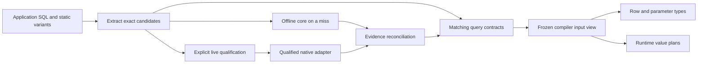

# Query contracts, hybrid analysis and live regeneration

> Implementation scope: this PR retains existing offline support without shipping an exhaustive
> upstream semantic catalog or vendor source-extraction pipeline. DuckDB has exact-engine cores
> and complementary compatibility packs; MySQL and PostgreSQL have selected-series/major cores;
> SQLite and SQL Server retain their small maintained catalogs in portable cores. Representative
> workload selection, complete vocabulary verification and the remaining acceptance evidence are
> still architecture targets. Native capabilities below require their own qualification evidence;
> this specification is not a completeness claim.

Status: final direction-change specification; implementation is in progress. This defines the
target architecture and acceptance requirements, not an assertion that they are implemented.

The [acceptance audit](./acceptance-audit.md) records scoped proof, open checks and current
qualification evidence against the unchanged requirements below.

This document supersedes the requirement to reproduce every engine's complete semantics offline
in [the preceding catalog specification](../grammar-completeness/spec.md). Its acquisition,
provenance, registry, generation and independent-auditing requirements remain useful. Existing
implementation evidence is historical evidence, not proof that this design is implemented.

The source investigation and engine-specific limitations are in [research.md](./research.md).
Measured source-graph bundle sizes and their remaining workload/installation gaps are in
[bundle-size.md](./bundle-size.md), with [machine-readable evidence](./bundle-measurements.json).
All commands, configuration fields, interfaces and paths introduced below describe proposed
behavior. They are not statements that the current CLI supports them.

## 1. Product decision

Make a project's query contracts the unit of correctness, generation, review and frozen
compilation. Use a compact offline analyzer and native descriptions as evidence producers for
those contracts. New common queries still receive immediate offline inference. Advanced queries
can receive exact native descriptions without a universal implementation of their functions.
In an explicitly enabled live development session, refresh evidence automatically as queries
or database context change.

The strongest supported workflow qualifies every statically renderable checked query against
the target engine, including queries the offline analyzer thinks it understands. This catches
confidently wrong static inference as well as missing support. Frozen builds consume the
exported contracts without loading the global analyzer catalogs or contacting the database.

The product has three layers:

| Layer | Contents | Generation authority | Offline reuse |
| --- | --- | --- | --- |
| Query contracts | Parameter/result descriptions, decoder bindings and qualified facts for exact rendered query variants | Offline rules, qualified native descriptions, or reconciled independent evidence; origins remain explicit | Primary input for matching queries and mandatory input to frozen compilation |
| Offline core | Vocabulary, supported syntax, expressions, operators, native type policy and common function semantics | Qualified grammar implementation and generated vendor facts | Immediate inference for new queries and an offline contract producer |
| Project catalog | Optional selected routine signatures, custom types, extension declarations and reusable semantics | Introspection plus explicit grammar-owned interpretation | Additional reusable evidence when it avoids repeated query-specific acquisition |

The distinction between project catalogs and query contracts is mandatory. Describing one
invocation never
creates a universal rule for that function. A fixed signature is not proof of argument-dependent
nullability, decimal dimensions, table output, JSON shape or execution effects.

The coverage target changes from universal offline semantic parity to:

- Comprehensive accounting of upstream inventories and explicit missing metadata.
- A declared, well-tested offline core for each supported grammar/profile.
- Reliable project-specific expansion where independent evidence supports it.
- Automatic live refresh in opted-in development hosts.
- Deterministic offline consumption and conservative behavior when evidence is insufficient.

There is no promise that a database can describe every statement, infer every parameter or
prove every semantic facet. Supported coverage is reported per facet and profile.

Implement exact query contracts before sophisticated automatic generation of reusable project
function rules. A project catalog is an optimization and extension mechanism, not a prerequisite
for supporting a describable long-tail query.



## 2. Invariants

1. Shared orchestration selects registered contributions and capabilities, never grammar-ID
   branches. Dialects and extensions own interpretation, syntax and native transport adapters.
2. Ordinary values remain parameters. Generation never evaluates application expressions or
   substitutes runtime values to choose a convenient overload.
3. Missing, stale, ambiguous or contradictory evidence never becomes an optimistic type or
   `any`. Known facets may survive while other facets remain unknown.
4. A native SQL identity and its application representation are separate. Inference and runtime
   decoding use the same versioned policy and codec bindings.
5. Grammar runtime imports do not acquire driver, parser, compiler, catalog-capture or refresh
   dependencies. Applications still import `sql` from their chosen grammar package.
6. Generated contracts are compiler inputs. Application code does not import generated query
   implementations or generated schema APIs.
7. Synchronous analysis performs no database I/O and never waits for a native request. Async
   hosts prepare an immutable artifact view, then invoke synchronous analysis.
8. Live operation requires explicit project or command activation. Credentials or an existing
   schema provider alone do not activate it. Production query execution never regenerates types.
9. Disposable caches and durable compiler contracts have different lifecycle and trust rules.
10. A prepared statement identifier is connection-local state, not a portable cached contract.
11. Native acceptance does not prove cardinality, volatility, routing safety or JSON structure.
12. A live response for an old document or context cannot update the current analysis view.
13. A contract hit precedes loading offline semantic catalogs. Frozen compilation needs the
    contract consumer, lexical/rendering profile and codec policy, not the full SQL analyzer.
14. Native qualification covers otherwise successful offline queries when required by project
    policy. Native fallback only on an analyzer miss is not the strongest qualification mode.

## 3. Offline scope and selection

Generate complete keyword inventories for declared profiles, including case comparison,
reservation class and contextual usage where the authority establishes them. `SELECT` and
`select` share an unquoted keyword identity; quoted identifiers and grammar-specific comparison
rules remain distinct. Do not apply universal Unicode folding or normalize executable SQL text.

Keep upstream parser declarations separate from observed engine permissions. An external parser
can classify a spelling differently from the engine, and contextual name restrictions can depend
on compatibility settings. Generate native context probes from the complete independent inventory,
retain source disagreements, and reconcile reviewed deltas under their exact engine/profile scope.
Persist the source, producer and artifact digests with the context ordering. A later audit checks
both the reviewed policy and its differences from upstream; missing or indeterminate evidence
cannot become a successful comparison. Normal generation and checking reuse these inputs offline.
Identifier-context observations do not establish complete syntax or function result semantics.

Vocabulary coverage is separate from syntax coverage. The core must recognize generic function
calls without an enumerated function-name allowlist, but special forms such as casts, conditional
expressions and table-producing syntax require their own supported grammar productions.

Treat 100–200 public function names per grammar as an initial distribution-size target, not a
hard semantic limit or an established popularity ranking. Select the core using:

- Representative application query corpora with documented licenses and sampling limits.
- Aggregation, null handling, strings, dates, numeric operations, JSON and window scenarios.
- Full query success rather than name recognition alone.
- Maintained semantic complexity, qualified profiles and incremental bundle cost.
- Compatibility with existing supported behavior.

Count names, aliases, signatures and semantic families separately. Preserve broadly reusable
semantic families even when they cheaply support more than the nominal name budget. Existing
offline functionality must not silently disappear to satisfy a smaller catalog count. Move it
to an explicit compatibility/optional pack when necessary and document the API transition.

Native scalar type families and codecs remain essential offline infrastructure. A rare function
returning an unrecognized type does not become usable merely because the server supplies its
name. Opaque custom types require a qualified codec/policy or remain unknown.

Optional offline packs use explicit analysis imports/profile loading. Pack metadata records
dependencies, versions, source digests and qualified facets. Installing a pack must not eagerly
load other grammars or every version, and must not enlarge the query runtime import graph.

## 4. Host modes and network policy

Define three host policies. The pure analysis API receives the same resolved inputs in each.

| Policy | Accepted inputs | Connections | Intended use |
| --- | --- | --- | --- |
| `offline` | Core, selected packs, durable contracts and matching validated local cache | None | Local builds/checks and disconnected editing |
| `frozen` | Lightweight grammar/codec profile and the explicit durable query-contract closure only | None | Reproducible CI/release checks; no new semantic inference |
| `live` | Offline inputs plus asynchronous native acquisition and refresh | Explicit configured adapter | Development editor/watch sessions and explicit live checks |

Default to `offline`. A configuration opt-in may enable live editor/watch operation; it does not
make normal build hooks contact a database. A command's explicit `--offline` or `--frozen`
overrides project live preferences. Build integrations require an explicit live prepass option
to connect; synchronous transforms cannot connect implicitly.

Frozen mode must ignore disposable caches even when they are present on the CI machine. Two
clean checkouts with the same durable inputs must produce identical contracts and diagnostics.
Every statically renderable checked variant requires a usable matching contract in this mode,
including common core queries. Missing contracts request generation; they do not trigger
implicit analyzer loading. `generate --queries --offline` can materialize contracts established
by offline rules when the qualification policy permits them.

Offline validity means valid against the declared recorded context. It does not mean the remote
database was checked recently. Keep evidence validity and connection/freshness status separate.

### 4.1 Qualification policy is independent of network policy

Configure `analysis.qualification` separately from `analysis.mode`:

| Qualification | Required evidence |
| --- | --- |
| `hybrid` | A usable contract can derive from qualified offline/project rules, native descriptions, or sound reconciliation |
| `native-required` | Every statically renderable checked variant needs qualified native acceptance and all native facets required by its declared profile policy; available static claims are independently reconciled |

`native-required` does not mean every facet is native-known. Required facets include enough
ordered result/parameter and codec evidence to justify the published application types.
Nullability may conservatively include NULL; cardinality may remain unknown with runtime guards.
Unknown dimensions, logical identity, bindings or decoding cannot be silently marked proven.
An adapter unable to satisfy a required facet produces an explicit qualification failure.

Scoped exceptions must identify the exact query/profile, reason and alternative qualification
evidence, and remain visible in coverage/review output. They cannot supply arbitrary optimistic
types or count as native-qualified. Dynamic SQL remains explicit untyped/unresolved scope rather
than being silently counted among contracted queries.

Recommended strongest project workflow:

1. Development uses live or offline mode according to connectivity, with immediate core results.
2. A qualification job creates a matching development database from migrations where practical,
   installs declared routines/extensions/settings, and uses `native-required` generation.
3. It compares semantic contract changes with the selected durable baseline and emits the exact
   compiler-input closure. CI checking can detect drift without overwriting the baseline.
4. A separate frozen build consumes that closure with database access denied.

Running generation and compilation against a live database in one mutable step is not a frozen
build. A disconnected job can validate existing durable inputs, but cannot claim to have checked
the current remote database. Migration/source snapshot digests and target configuration belong
to the declared qualification input so changes cannot bypass refresh.

## 5. Proposed developer workflow and commands

The existing schema generation flow remains available. Query acquisition extends it rather than
changing live verification into an inference API by implication.

| Proposed operation | Behavior | Writes |
| --- | --- | --- |
| `typed-sql check` | Offline analysis; consume matching available evidence | Disposable local indexes only if needed |
| `typed-sql check --frozen` | Ignore disposable cache; require declared reproducible inputs | No semantic inputs |
| `typed-sql check --live` | Async acquisition/qualification prepass under the selected policy, then ordinary checks | Disposable cache |
| `typed-sql generate --queries --live` | Acquire project metadata and query contracts, reconcile and emit compiler inputs | Configured durable contract directory plus cache |
| `typed-sql generate --queries --offline` | Emit from validated existing evidence or qualified core rules; fail when the selected policy requires missing native evidence | Durable contracts |
| `typed-sql check --watch --live` | Request-driven refresh as source/context changes | Disposable cache; no tracked-file churn |
| `typed-sql cache status` | Explain hits, context, pending requests, invalidation and pending durable export | None |
| `typed-sql cache prune` | Remove unreachable/expired disposable entries, respecting active writers | Disposable cache only |

These are proposed extensions to existing commands, including new flags/subcommands. They need
CLI/config validation and tests before documentation can present them as available behavior.
Existing `verify --live` keeps its purpose: independent comparison with a compiler claim.
Provide `--qualification native-required` for project-wide native qualification and
`generate --queries --live --check` for comparing reacquired semantic contracts with the durable
baseline without replacing it. Cache-only refresh does not satisfy frozen inputs until exported.

The user-facing sequence is:

1. Write a query. The offline core or project catalog resolves it immediately when possible.
2. An unresolved facet produces a specific diagnostic and available remedy.
3. In live mode, the host schedules acquisition and reports pending status. Otherwise the user
   can explicitly run generation.
4. A validated result installs a new immutable artifact view and triggers reanalysis.
5. Explicit generation exports the accepted inputs for teammates and frozen CI.
6. Source/context changes invalidate only what can safely be isolated; uncertain dependency
   scope invalidates the whole affected context.

Proposed configuration groups are `analysis.mode`, `analysis.contractsDir`, `analysis.packs`,
`analysis.qualification`, `analysis.live.adapter`, scheduler limits and cache limits. The default
contract directory is
`<outDir>/contracts`; all paths resolve relative to the existing configuration file. Adapter
construction is lazy. Connection strings and credentials are obtained at connection time and
are never serialized into these configuration-derived identities.

## 6. Resolution algorithm and evidence reconciliation

For each statically renderable variant:

1. Extract the exact SQL bytes, ordered placeholder occurrences, source mapping, known
   parameter constraints and structural identity independently of semantic success.
2. Load the lightweight selected grammar/codec profile and compatible contract index. Do not
   load full semantic catalogs to construct this profile or look up a contract.
3. Look up a matching query contract. Its query, context, policy and qualification keys must
   match before any facet participates in inference. A usable hit supplies compiler input
   without loading the offline analyzer.
4. On a miss in frozen mode, emit a missing/incompatible-contract diagnostic. In offline/live
   modes, lazily load the compact analyzer and selected project/pack declarations. Run static
   analysis and record each facet's owner, completeness and evidence.
5. During acquisition/qualification, reconcile evidence through grammar-owned rules. Fill missing facets only where
   the native adapter establishes them. Never silently override a known disagreement.
6. Check decodability and ordered parameter constraints; produce the final row/parameter types,
   diagnostics and current source spans.
7. In live mode, enqueue missing/stale admissible evidence. With `native-required`, also enqueue
   unqualified variants that already have an offline result. Return current conservative
   development results with explicit qualification status; completion causes a new pass.

Live generation operates on extracted candidates even if offline analysis cannot resolve them.
When strict qualification is requested it also invokes applicable offline rules for independent
comparison. It never considers an old manifest entry's `resolved` status sufficient native proof.

A native result and static result must not be blindly intersected or selected by recency.
Examples: a native type disagreement is a blocking conflict; native nullable metadata may be a
conservative upper bound; an offline non-null refinement needs an independently justified rule;
a JSON database type cannot confirm a declared nested object shape. The owner records a
facet-specific reconciliation rule. Unknown evidence cannot strengthen a claim.

Diagnostic classification distinguishes a parser's unsupported production from a proved invalid
statement. A qualified native whole-query path can supply missing result facets for the first
case. It cannot blanket-suppress existing syntax, binding, interpolation or safety diagnostics.
If an owner asserts invalidity and the engine accepts the same scoped statement, retain a
conflict for investigation rather than silently trusting either implementation.

Server syntax/type rejections are negative evidence for that exact query/context. They cannot
be hidden by an earlier positive result. Permission failures, disconnects, timeouts and metadata
limitations are separate acquisition outcomes, not proof that the SQL is invalid.

## 7. Project catalogs and reusable rules

Project catalog entries preserve native identity, qualification, argument modes/names/defaults,
availability, type expressions, table outputs and raw evidence references. Record missing
fields explicitly. Acquire the dependency closure actually used by the project where known;
do not require downloading every built-in or extension to describe one statement.

Each routine declaration states its inference permission:

| Permission | Meaning |
| --- | --- |
| `declaration-only` | Name/signature/availability known; reusable result semantics unproven |
| `fixed-result` | Qualified fixed native result identity; conservative nullability and known codecs |
| `qualified-rule` | Versioned grammar/plugin semantic rule with required evidence and constraints |
| `query-only` | Particular invocations can be described; no reusable rule is asserted |

Fixed-result permission is deliberately narrow. Defaults can affect overload selection;
polymorphism, dependent dimensions, record outputs, dynamic SQL and overloaded coercions need
a qualified rule or an exact query contract. Strictness alone does not prove every non-null
input produces a non-null output. No sampled values or generated wrappers infer such rules.

Extension contributions register their own identities, versions, rules, codecs, fingerprint
inputs and qualification tests. They may inherit a base grammar's mechanics. Conflicting
registrations fail before analysis; installation order cannot decide ownership.

## 8. Query contract model

Contracts are canonical, versioned, validated data. Generated declarations derive from these
records; they are not the only retained evidence. A contract contains:

- Format/version, content digest and acquisition/interpreter revisions.
- Producer/evidence origin: `offline-rule`, `native-description` or reconciled independent
  evidence, with per-facet authority and qualification policy. A cache hit is not an authority.
- Query digest and rendered variant identity; parameter occurrence/order and logical slot map.
- Grammar/profile, contribution and optional pack identities/digests.
- Recorded schema and engine-context identities; freshness/consistency scope.
- Ordered result fields, including ordinal, label, native logical identity, modifiers, alias or
  domain identity, collation, nested type structure and nullability evidence when available.
- Ordered parameter slots with native identity, constraints, provenance and ambiguity status.
- Representation-policy and codec bindings with decoder implementation/version constraints.
- Evidence completeness per facet; limitations and a stable reason for every required unknown.
- Dependencies and dependency-completeness status; a coarse context dependency when unknown.
- Native invocation/transport evidence references and acquisition outcome.

Represent unknown nullability separately from known nullable metadata. Both project to a
nullable application type until a sound refinement exists. Preserve a known SQL family with
unknown modifiers without treating a default column declaration as its exact native identity.
An incomplete native identity never earns a complete identity verification claim.

Result fields remain ordered until labels are validated. Duplicate/unknown labels cannot be
silently collapsed into an object row. Require aliases or an explicit qualified alternative
row representation before generating an application object type.

Contract semantic bytes exclude source absolute paths, timestamps, host names and credentials.
Observation timestamps and local source locations live in sidecars. Relative source mapping is
rebuilt from current extraction, so moving a file does not reuse obsolete spans.

## 9. Parameter inference

A TypeScript `number` does not uniquely specify a SQL integer, decimal or floating type.
JavaScript runtime samples must not choose the overload used for a generated contract.

Parameter authority, in order, is an explicit supported SQL/native type constraint, qualified
static context, or meaningful native parameter description. An owner may reconcile equivalent
constraints. Unresolved/contradictory slots produce a diagnostic requesting a supported cast,
declaration or other explicit existing parameter annotation. No invented default SQL type.

If typed preparation is supported, it must use declared native parameter identities without
executing application values. A generic placeholder descriptor or parameter count is not a
qualified bind type. A contract is reusable only under its recorded parameter vector and any
binding-sensitive constraints. A changed parameter type invalidates its query contract.

Repeated logical parameters retain every placeholder occurrence and source span. Native
position counts and compiler logical slots must be reconciled explicitly, not zipped by an
assumed one-to-one relationship.

## 10. Structural variants, unknown syntax and dynamic SQL

Finite conditional fragments require descriptions for all possible rendered structures. A
contract covers exactly one variant unless an owner has independently qualified a structural
equivalence rule. Variant explosion remains bounded by the existing project limit; exceeding it
produces a diagnostic rather than selecting a representative branch.

Repeated fragments are not assumed equivalent across item counts. Type/result invariance must
be proven by a qualified rule; otherwise each concrete finite variant requires evidence.
Arbitrary identifier interpolation, trusted raw content and dynamic SQL stay explicit boundaries.

For unknown grammar syntax, an optional whole-query description path may operate only when:

- The compiler has a complete, static SQL rendering and exact parameter occurrence mapping.
- A grammar-owned lexical scanner can establish boundaries without rewriting SQL.
- The selected native primitive is qualified for that statement class/context.
- The adapter can obtain useful descriptors without falling back to query execution.

This path bypasses unsupported semantic parsing, not interpolation safety or runtime policy.
It does not invent AST nodes, object dependencies, effects, cardinality or routing safety.
Unknown effect/routing facts retain conservative primary/affinity behavior. Unsupported
statement classes, multiple result sets or transaction-scoped temporary state remain explicit
limitations unless an owner provides a qualified protocol.

## 11. Cache layout and durable exports

Use the existing `.typed-sql` workspace root without replacing existing init journals,
verification proofs, query manifests, plans or migration artifacts. Allocate a versioned
subdirectory with its own ownership marker:

```text
.typed-sql/
  cache/analysis/v1/
    ownership.json
    contexts/<context-digest>.json
    catalogs/objects/<content-digest>.json
    queries/objects/<content-digest>.json
    indexes/<workspace-context>.json
    observations/<context-digest>.json
    failures/<request-digest>.json
    declarations/<generation-digest>/...
    locks/...
    staging/...

<outDir>/contracts/
  manifest.json
  contexts/<context-digest>.json
  catalogs/<content-digest>.json
  queries/<content-digest>.json
```

The first tree is disposable and ignored by version control. The second is a reviewable compiler
input set suitable for committing or supplying as a pinned CI artifact. Export contains only
the dependency closure required by the selected project. Local failures, credentials, absolute
paths and transient freshness state do not enter durable exports.

Generated executable declarations are rebuildable. Durable evidence JSON is not confused with
generated executable code. Deleting `.typed-sql/cache/analysis` preserves frozen results when
durable inputs cover the project; deleting durable inputs cannot magically preserve long-tail
offline support.

An explicit generation request emits a semantic diff: added/removed queries or declarations,
changed native identities/parameters/nullability/codecs, unresolved facets and affected callers.
Editor live refresh never modifies the durable directory by default.

## 12. Cache identities

Use content-addressed immutable payloads and mutable local lookup indexes. A query lookup key
contains the following independently versioned components:

| Component | Required identity |
| --- | --- |
| Query | Exact rendered SQL digest, placeholder layout and structural variant descriptor |
| Parameters | Ordered native type constraints and qualified binding-sensitive properties |
| Grammar | Grammar/profile/interpreter versions, selected packs and inherited contributions |
| Database context | Logical target binding, engine product/version/build/edition and schema/catalog epoch |
| Resolution environment | Database/schema/search path, authorization context, extensions and semantic session settings |
| Representation | Type policy, codec registry and compiler/runtime compatibility requirements |
| Protocol | Descriptor schema and adapter version/capabilities |

A local endpoint fingerprint is private operational state; a sanitized logical target/profile
binding is the portable input. No credentials or credential hashes are included. Changing the
database endpoint requires a new live handshake or explicit selection of a matching recorded
target; matching schema text alone cannot authorize silent cross-target reuse.

Exact SQL bytes are the initial identity policy. Do not strip comments, fold case, renumber
placeholders or normalize literals: hints and grammar/mode differences can make those changes
semantic. A future canonicalizer needs its own qualified versioned equivalence contract.

Formatting-only edits may miss the persistent cache. File moves with identical rendering can
reuse evidence while regenerating source spans. Bound runtime parameter values never enter keys.
Static SQL literals remain part of query identity because they can change type or result shape.

The owner must also establish description stability under the recorded parameter vector. If
an engine can change the result shape when a parameter value is bound, a description of one
binding is insufficient. Require a qualified invariant, a finite explicit structural input, or
an unavailable/partial result. Do not put ordinary application values into cache keys to hide
value-dependent inference. Metadata sources that bind defaults or dummy NULLs must record that
limitation and cannot publish a general parameterized contract from the observation alone.

## 13. Freshness and invalidation

Keep three concepts separate: input match, observed database freshness and connection status.
A content digest proves bytes match; it does not prove the database has not changed.

| Change/event | Required behavior |
| --- | --- |
| SQL, structural variant or parameter type changes | Invalidate that request immediately |
| Decoder/type policy changes | Reproject from adequate native evidence or reacquire; never reuse old TS types blindly |
| Schema/catalog epoch changes | Invalidate dependent contracts; use context-wide invalidation if dependency coverage is incomplete |
| Function definition/strictness, extension or semantic setting changes | Invalidate relevant rule/catalog/query evidence |
| Authorization, search path, database, engine/build or target binding changes | Establish a new context namespace |
| File move/document version changes | Rebuild local source mapping; do not unnecessarily reacquire identical SQL |
| Database becomes unavailable | Preserve valid recorded-context artifacts; mark remote freshness unverified |
| Known incompatible context observed | Retire incompatible evidence even if the database later disconnects |
| Package/adapter protocol changes | Revalidate compatibility; reject unsupported artifact versions |

Every owner supplies a fingerprint plan and declares its coverage. A generic table-schema hash
is insufficient for routine bodies, UDF registration, extensions, collations or session settings.
Unknown dependency scope does not enable fine-grained invalidation. Cheap engine epoch tokens
are useful only for the domains they actually cover.

Default editor context revalidation is request-driven and coalesced: at most one context check
per five-second interval for an active context. This is an initial configurable load target,
not a correctness TTL. Explicit refresh/generation checks context immediately. Optional database
or migration notifications can trigger earlier invalidation; no idle full-catalog polling is
required. Display when the last context check happened.

For a running live watch session, an adapter with a qualified bounded fingerprint mechanism
may additionally schedule a five-second active-session check, allowing external DDL to trigger
regeneration without a source edit. Coalesce this with request-triggered checks and stop when
the project/session closes. Adapters without that capability report request-driven freshness
explicitly; they must not imply that idle remote changes are detected. Background full-catalog
polling needs explicit configuration and a measured budget. Notification-driven and polling
detection paths use the same invalidation/publication protocol.

Capture context before and after native description. If it changes, discard and retry under a
bounded policy. The owner records whether consistency was snapshot-protected, checked before/
after, or unavailable. Before/after equality alone is not a claim of serializable DDL isolation.
Frozen inputs are scoped to the captured context; live currentness depends on the qualified
fingerprint mechanism and its observation window.

## 14. Live scheduler and publication

The host owns an asynchronous state machine:

| State | Analysis behavior | Scheduler behavior |
| --- | --- | --- |
| `missing` | Core/project facts plus evidence-needed diagnostic | Enqueue in live mode |
| `pending` | Conservative current facts; pending status | Deduplicate identical requests |
| `usable-recorded-context` | Reuse matching qualified facets | Revalidate context when due in live mode |
| `stale-input` | Do not apply old query-specific types | Cancel/supersede and acquire current input |
| `stale-context` | Do not apply incompatible contracts | Refresh affected closure |
| `partial` | Preserve known facets and explicit limitations | Retry only on a relevant change or explicit request |
| `rejected` | Report exact native rejection | Negative-cache by full request/context key |
| `unavailable` | Use matching recorded evidence if still valid; otherwise unknown | Back off transport attempts |
| `conflict` | Blocking diagnostic with evidence references | Require corrected analysis/context; no winner by recency |

Default starting limits: 300 ms debounce for source edits, two description jobs per connection
context, sixteen queued interactive requests per project, a five-second native request deadline,
and transport retry delays of 1/2/4/8/16/30 seconds with jitter. These are proposed tunable budgets,
not measured performance claims. Batch generation uses a separate bounded queue, not the
interactive queue limit. Queue eviction preserves pending diagnostics and can reschedule on
the next request. Authentication/configuration failures wait for a relevant change or explicit
retry; they do not produce an endless connection loop.

One shared request may serve multiple documents. Cancel underlying work only when no current
subscriber requires it. Some drivers cannot cancel safely; drain or discard their connection,
and discard obsolete results in every case. Requests capture document version, compiler input
generation, context generation and policy generation. Publication compares all four.

Validate payloads, limits, parameter/result order and codecs before publication. Stage immutable
objects, then atomically replace the local generation/index pointer. Emit at most one coherent
analysis generation; consumers never read a mix of new columns and old parameter plans.
Cross-process writers use locks, stale-lock recovery and generation fencing. Clear/prune cannot
delete another command's staged output or unrelated `.typed-sql` data.

Native success is validated evidence, not automatic approval of incompatible row or parameter
changes. Live development may install the new context view with a visible diff/status; durable
exports change only through explicit generation. Pending requests never rewrite application SQL.

## 15. Compiler and editor integration

The compiler extracts candidates before requiring full grammar semantics. This is necessary
because the existing verification path starts from already resolved compiler claims; it cannot
serve as the unresolved-query acquisition path unchanged.

Split a lightweight grammar/codec profile from the loaded analyzer implementation. That profile
contains identities, render/placeholder/source-boundary mechanics, policy and explicit lazy
analysis/adapter contribution references. Constructing it cannot import a global routine/type
catalog. The current eager `dialect: grammarFactory()` configuration needs an explicit compatible
migration or breaking-release transition to this descriptor; wrapping an eager factory in a
callback after importing its analyzer module does not establish the required bundle boundary.

Async host setup loads an artifact view and optional native adapter. The synchronous analyzer
receives a read-only `ContractResolver` and returns diagnostics plus evidence requests. A host
scheduler resolves requests and replaces the view. Do not make `DialectPlugin.analyze` return a
promise or insert blocking database calls into TypeScript callbacks.

The language server is the editor orchestration boundary. Preview-backed TypeScript integration
consumes the same resolved views but does not become a dependency of stable packages. Generated
declarations in the disposable cache update atomically, trigger targeted project invalidation,
and do not create watcher loops. Hash equality suppresses redundant writes/restarts.

Diagnostics distinguish: missing project metadata; native description pending; unavailable
connection; unsupported descriptor facet; stale inputs/context; ambiguous parameters; native
rejection; evidence conflict; unqualified statement class; excessive variants. Codes are assigned
through the existing diagnostic registry during implementation, not invented in this spec.

Show evidence origin and context in hover/explain output. A previously resolved row type may be
shown as historical information while refresh is pending, but it cannot remain the active
compile-time type after its inputs are known to be incompatible.

## 16. Runtime contract and distribution

Query contracts feed the existing compiler path for inferred rows, ordered parameter tuples,
source spans and runtime value plans. A contract cannot produce a type which the configured
adapter/codec cannot decode. Unknown JSON structure stays a general JSON type; an unknown
custom decoder yields unknown/diagnostic rather than an assertion.

Runtime execution consumes the compiled value plan and SQL renderer. It does not load native
description clients, source inventories, `.typed-sql`, the compiler or editor services. Runtime
schema/target compatibility checking remains a separate explicit adapter capability; offline
generation does not guarantee that a deployment database never drifts afterward.

Measure query runtime, offline analyzer, optional packs, project metadata and tool distributions
separately. A smaller function list is not evidence of a smaller production bundle. Packed
consumer/bundler tests must prove that analysis catalogs and drivers are absent from ordinary
query runtime imports and that unrelated packs/versions can be excluded.

## 17. Native adapter capability contract

Register adapters by contribution identity and declared profile capabilities. The neutral
contract exposes conceptual operations for inspecting context, acquiring project metadata,
describing a query, reporting invalidation coverage, cancellation and closing resources.
Capabilities state supported statement classes, parameter authority, descriptor facets,
consistency mechanism, external-resource behavior and known limitations.

| Grammar | Initial mechanism to qualify | Important boundary |
| --- | --- | --- |
| PostgreSQL | Parse/Describe plus catalog identity lookup | Row type metadata does not itself establish expression nullability or cardinality |
| MySQL | Native statement preparation and column definitions | Parameter descriptors and logical/modifier identity need independent qualification |
| SQL Server | Result-set description and supported parameter metadata APIs | Some batches, temporary-state and dynamic forms cannot be described |
| DuckDB | Version-qualified prepared logical-type descriptors | Bind-time table functions/external sources and API availability need capability checks |
| SQLite | Prepare/catalog metadata plus static rules or explicit extension declarations | Arbitrary expression result types are not universally available without execution |

The engine facts underlying this table are sourced in [research.md](./research.md). This is a
capability plan, not a new support claim for every retained version or driver.

No adapter falls back to executing SQL with dummy values, `LIMIT 0`, `EXPLAIN ANALYZE`, or a
transaction/rollback wrapper to obtain a missing type. Preparation/binding can itself have
engine-specific effects or external access. Unknown statement classes, session-mutating pragmas,
extension loading and external-resource binding require explicit owner qualification and
appropriate project policy; otherwise acquisition is unavailable. Automatic development uses a
restricted configured development connection and finite deadlines.

## 18. Storage, privacy and resource behavior

Persist schemas, descriptors and digests, not connection strings, tokens, bound values or raw
native error messages by default. SQL is rendered from current source for an active request;
the cache does not need stored SQL text to issue historical requests on its own. Optional local
debug captures require an explicit setting and are never promoted into durable exports.
Query digests are identity mechanisms, not a guarantee that low-entropy SQL literals are secret.

Cache roots are private project-owned directories. Validate ownership/version, bounded payload
sizes, safe relative paths and content digests before reading. Reject corrupted/truncated or
incompatible entries; do not evaluate cache files as executable modules. Persisted TypeScript
declarations are generated from validated data and cannot supply executable adapter code.

Namespace workspaces, configs and target contexts explicitly; a multi-root editor cannot share
types across projects merely because their SQL text matches. Cache maintenance is idempotent
and scoped. Initial size/retention targets are 256 MiB and 30 days for unreachable disposable
objects, configurable and subject to measurement. Referenced active generations and durable
contracts are not evicted by that policy.

## 19. Repository ownership and expected topology

The proposed new neutral analysis package avoids a dependency on TypeScript or a built-in
driver. Its input is the compiler's neutral candidate/parameter/source-map representation.
This is a package-boundary decision to validate before implementation, not an instruction to
duplicate existing compiler extraction or artifact serialization.

```text
grammar/                                  retained full inventories, policies and profile/source locks
metadata tooling (separate future scope)  optional reusable catalog acquisition and auditing
packages/core/src/                       neutral query/type/evidence contracts and runtime primitives
packages/schema/src/                     schema snapshots and catalog envelope primitives
packages/analysis/src/                   proposed stable orchestration package
  contracts/                             validated catalog/query evidence and reconciliation mechanics
  artifacts/                             canonical serialization, import/export and compatibility
  cache/                                 immutable objects, indexes, locks and pruning
  scheduler/                             requests, cancellation, fencing and backoff
  context/                               fingerprint/dependency contracts and freshness state
packages/<grammar>/src/analysis/
  core/                                  compact generated metadata plus maintained semantic families
  packs/                                 explicit optional analysis contributions
  project/                               native-to-project interpretation and codec qualification
  generated/                             disposable build projections by profile/pack
packages/<grammar>/src/<driver-adapter>   optional live acquisition/description exports; driver boundary retained
packages/compiler/src/                   extraction and synchronous contract consumption; existing emission path
packages/config/src/                     modes, lazy adapter configuration, paths and validation
packages/cli/src/                        async command orchestration and durable export
packages/language-server/src/            live development scheduling and artifact-view invalidation
packages/ts-bridge/src/                  isolated preview integration over the same contract view
test/contracts/                         boundaries, offline determinism, artifacts, plugins and packed consumers
e2e/                                    qualified native transports, refresh/drift and decoded consumer behavior
```

Dependencies flow from compiler/CLI/editor hosts toward neutral analysis mechanics. The analysis
package cannot import the compiler, preview integration or built-in grammar implementations.
Composition modules register built-ins once. A third-party grammar/extension can supply owners
without modifying neutral orchestration or an engine-name allowlist.

Each grammar also exposes a lightweight profile entrypoint and retains its lightweight query
entrypoint. Application `sql` imports stay unchanged. Development analyzers, reusable optional
packs and native adapters are separate lazy modules. Frozen consumers must work when those
modules and the global catalog inputs are physically absent from the consumer installation.

The lightweight root cannot statically import/re-export heavy analyzer implementations, even
when a bundler can tree-shake their unused exports. Unbundled ESM still resolves that graph.
Move eager analyzer factories to an explicit analysis/compatibility entrypoint through the
declared API migration. Constructing the lightweight profile must not require registering or
resolving optional implementation loaders. The explicit contribution boundary must establish
the physically absent heavy-module case; a lazy-looking function around an eager import is
insufficient.

Use explicit host registration as the default boundary: lightweight profiles contain no direct
import of analyzer/native implementation modules; development hosts register their lazy analysis
contributions separately, and frozen hosts do not register them. Durable/cache JSON cannot
introduce executable loader references. The final lightweight-root transition is a breaking
release when existing root analyzer exports cannot be preserved without eager dependencies;
provide an explicit compatibility entrypoint and migration guidance rather than silently changing
the existing stable export contract.

## 20. What carries forward and what changes

| Existing work/requirement | Direction-change disposition |
| --- | --- |
| Source locks, full inventories and provenance | Retain; tools/audit inputs, not mandatory runtime distribution |
| Validated IR and loss accounting | Retain; add explicit reusable-rule versus query-evidence scope |
| Mapper, contribution, acquisition and emitter registries | Retain and extend through declared capabilities |
| Native comparisons and bug witnesses | Retain; qualify both offline rules and generated query contracts |
| Manual global long-tail semantic algorithms | Stop expanding solely to reach universal offline parity |
| Full offline signature/semantics migration | Replace with core/pack selection and project/query acquisition |
| Reusable project mapping generation before query support | Defer behind the exact query-contract path; add only qualified reusable rules |
| Native fallback only for unresolved queries | Add project-wide native-required qualification to catch incorrect successful inference |
| Profile loading, tree-shaking and runtime separation | Retain as required distribution work |
| Generated executable code disposable at build | Retain; distinguish it from durable normalized facts/contracts |
| Live verification of already resolved queries | Retain; do not treat it as unresolved inference without a new path |
| Extension support | Retain; add context fingerprints, native capability and project contributions |
| Coverage/gap reporting | Retain; split inventory, offline, project-catalog and query-description coverage |
| Merge readiness | Re-audit against this accepted design; prior green checks do not prove new behavior |

The preceding implementation ledger is not silently rewritten as completed. When implementation
resumes, each old requirement gets an explicit retained/replaced/deferred disposition and an
associated new acceptance test. Preserve existing fixes independently of this product change.

## 21. Coverage, size and maintenance measurements

Report these dimensions for each grammar/profile and selected workload:

- Upstream inventory accounting and reservation/syntax facts with explicit unknowns.
- Core and pack name/signature/rule coverage, including fully qualified semantic facets.
- New-query offline success on a clean checkout.
- Additional success from project catalog declarations.
- Additional success from exact query contracts, with completeness per facet.
- Frozen project success after durable export and after deleting disposable cache.
- Cache hit rate, acquisition count, latency, queue pressure and remote freshness checks.
- Runtime/analyzer/pack/durable-artifact compressed bytes and loaded modules.
- Maintained semantic code, generated code, acquisition tools, orchestration code and tests.

Do not label recognition as semantic support or translate catalog counts into popularity.
Workload reports record corpus selection and the fraction of whole queries requiring a database
at first use. A live query contract contributes project-query coverage, not universal function
coverage. SQLite's unknown expression facets cannot count as inferred because preparation succeeds.

No numerical LOC reduction is promised from the preceding baseline. The expected mechanism is
less maintained global long-tail semantics, with new maintained cache/orchestration logic and
more generated project inputs. Measure the net delta after a vertical prototype; stop treating
moving rows from TypeScript into JSON as a maintenance reduction.

### 21.1 Measured bundle baseline and removal boundary

The [bundle-size investigation](./bundle-size.md) compares twenty historical synthetic entrypoints from
committed revision `a1f27fc894e48021e91ce4c9a4b98929890f233d`, using esbuild 0.28.2,
minified ESM, Node platform, ES2022 and tree-shaking. Source comes from Git blobs, not the
pending working-tree implementation. Values below are KiB (1,024 bytes).

| Grammar | Whole analyzer, minified | Whole analyzer, gzip | Generated input contribution, minified | Share of minified analyzer |
| --- | ---: | ---: | ---: | ---: |
| PostgreSQL | 1,649.9 | 131.8 | 1,411.6 | 85.6% |
| MySQL | 180.6 | 43.2 | 37.8 | 20.9% |
| SQLite | 154.7 | 39.5 | 19.5 | 12.6% |
| SQL Server | 138.7 | 35.6 | 23.0 | 16.6% |
| DuckDB | 1,340.3 | 101.4 | 1,219.7 | 91.0% |

These generated contributions describe that historical exhaustive pipeline, not the current
implementation. The current [machine-readable report](./bundle-measurements.json) remeasures
the same four source scenarios and adds profile/frozen-host scenarios for all five grammars.
The analyzer-only current minified sizes at `c9e4a793` are 383.8 KiB PostgreSQL, 185.4 KiB MySQL,
148.6 KiB SQLite, 121.1 KiB SQL Server and 627.8 KiB DuckDB. DuckDB core samples are
234.3/246.0 KiB for 1.5.6/2.0.0, with matching full per-engine samples at 360.0/385.0 KiB.
MySQL selected full/core samples are 163.1–163.8 KiB and retain its full maintained routine set;
measured small-family pack overhead exceeds the metadata saving, so no extra pack is introduced. These net changes include pipeline removal,
semantic corrections and API separation; they do not isolate the effect of query contracts.
Some compact generated vocabulary/type/codec metadata remains. Do not multiply the gzip column
by the historical minified generated share.

The current tree-shaken root `sql` tag samples retain zero global grammar catalogs in all five
grammars. Historical execution-factory samples retained only 0–3.6 KiB of generated lexical/type projections.
Consequently there is no large additional production-tag catalog saving to promise. The major
win is avoiding global analyzer catalogs in contract-only compilation and
isolating profiles/packs. Profile isolation independently saves unused versions; it is not a
benefit unique to query contracts. Current frozen hosts contain zero global grammar catalog
inputs but include contract loading and compilation machinery; SQL Server's helper sample is
slightly larger than its analyzer-only sample. The current report measures DuckDB core/pack
distribution. The separate commerce workload measures offline-rule artifact, schema and value-plan
growth; native-qualified payload/latency and representative production selection remain open.
Fresh installed package payloads
are reported separately, including their maps/declarations and mandatory dependencies; they do
not represent filesystem/store usage or complete application toolchains.

Final distribution requirements are zero global analysis catalog bytes in runtime entrypoints,
zero global analyzer catalog bytes in frozen contract-only consumers, and explicit bounded
loading of selected core/pack/profile data in development. Generated per-query value plans and
required compact codecs are retained intentionally. Npm/tool installation sizes and application
bundles are reported separately; retaining source inventories in private tooling is compatible
with eliminating them from consumer bundles.

## 22. Delivery sequence and acceptance gates

| Phase | Deliverable | Exit evidence |
| --- | --- | --- |
| 0 | Accept direction and inventory reusable existing paths | Written disposition of old requirements; no coding implied by this spec |
| 1 | Query-contract consumer and one vertical native-described query through a registered adapter | An unresolved variant gains rows/parameters and matching decoding, then compiles disconnected without loading full analyzer catalogs |
| 2 | Validated artifact model, immutable cache and durable export | Clean-room frozen rebuild, digest/compatibility/corruption and deletion tests |
| 3 | Parameter/variant boundaries and project-wide native qualification | Polymorphic/default/ambiguous cases cannot generalize; all finite structures and otherwise successful offline queries are qualified or diagnosed |
| 4 | Live CLI/watch and editor scheduling | Edit/schema/policy races, disconnect/reconnect, backoff, cancellation and multi-process tests |
| 5 | Five grammar capability profiles and inherited extension | Native qualification reports per facet; SQLite/unsupported transports expose limitations honestly |
| 6 | Core/pack distribution, optional reusable project catalogs and performance | Measured workload selection, justified rule reuse, compatible migration, packed runtime/frozen graphs and tree-shaking evidence |
| 7 | Complete migration and PR qualification | Required repository/native/editor/packed gates plus the acceptance audit below |

Use PostgreSQL as a first candidate for the vertical prototype because native query/parameter
descriptions and catalog tooling already exist. The registered contract must be exercised by an
inherited synthetic contribution in the same phase; no one-engine private shortcut can become
the shared interface. Profile/driver selection remains explicit implementation work.

## 23. Required acceptance scenarios

1. A new core query works with network denied and no cache.
2. A supported long-tail invocation resolves from a qualified project declaration without a
   new database call; an unqualified polymorphic invocation requires its own query contract.
3. A missing exact contract yields an actionable conservative diagnostic offline.
4. Opted-in live acquisition updates types, parameter order, runtime plans and source spans;
   generation does not execute the application statement.
5. A matching contract works after disconnect and process restart. A known stale contract does
   not become valid again because the connection is unavailable.
6. A clean checkout with durable inputs passes frozen checking without `.typed-sql`, network,
   full analyzer modules or global catalog files. Every checked variant has a matching usable contract.
   Deleting a necessary durable input produces an explicit missing-input failure.
7. Exact SQL/literal/parameter/variant changes miss the old contract; file moves preserve useful
   evidence but regenerate spans. A result for an old document cannot publish after a new edit.
8. Schema, routine definition, extension, authorization, search-path, semantic setting, engine
   profile and codec changes follow the declared invalidation scope.
9. An unknown dependency invalidates the context rather than assuming independence. A DDL race
   cannot publish evidence for a mismatched captured context.
10. Native/static disagreements block publication. Unknown nullability stays nullable; unknown
    JSON/custom type/precision remains explicitly incomplete. Decoder mismatches fail closed.
11. Ambiguous and repeated parameters, named/default calls, table outputs and finite conditional
    structures preserve their actual constraints. One prepared invocation cannot prove a family.
12. Unknown syntax can use only the qualified static-rendering/native path. Dynamic raw SQL,
    unsupported result sets, temporary state and unqualified statement classes stay diagnosed.
13. Core, project and native evidence preserve partial facets through subqueries, CTEs,
    compounds, parameter inference, manifests and verification; incomplete facets never certify.
14. Live mode opens no driver on import/config load, emits no application values or credentials,
    and respects workspace/target isolation, queue limits and cleanup.
15. A fresh cache clear, corruption, interrupted write, concurrent writer and prune race cannot
    produce torn metadata or remove unrelated `.typed-sql` artifacts.
16. Normal build hooks perform zero database calls; explicit live prepasses do so predictably.
    Frozen output is independent of local caches, clock and host paths.
17. All five grammars and a contributed extension use the same orchestration. Every descriptor
    capability is backed by exact-version tests or reported unavailable.
18. Runtime packed consumers carry only renderer/value-plan/codec requirements. Optional packs,
    unrelated profiles, native clients and analysis tooling stay outside their import graph.
19. Full required quality, type, coverage, documentation, native, packed, editor and performance
    checks pass with reviewed evidence; no timeout/budget changes substitute for fixing failures.
20. A deliberately wrong but apparently resolved offline rule is rejected by project-wide
    native-required qualification. A corrected query contract cannot silently conceal the conflict.
21. A migrations-derived qualification database and durable contract export feed a separate
    network-denied frozen build. Missing routines/extensions/settings fail explicitly; an
    unqualified environment is not accepted because its table names happen to match.
22. Future bundle benchmarks repeat the baseline scenarios and add a realistic project contract
    corpus, reporting minified/gzip/Brotli, input attribution, installation size and schema/plan
    growth separately. No projected percentage substitutes for measured after-results.

## 24. Decisions fixed here and remaining investigation

Fixed: query contracts as primary compiler inputs; three evidence layers; project-wide strict
native qualification; comprehensive audit accounting; bounded offline semantics; explicit
live activation; synchronous pure analysis; `.typed-sql/cache/analysis` as disposable storage;
separate durable exports; contract-first lazy loading; no universal rules from sampled
invocations; registered capability owners; facet-level uncertainty; no runtime regeneration.

To establish during the prototype: the exact core selection per grammar, reusable metadata
qualification depth, owner-specific fingerprint costs and consistency scope, package API
surface, initial storage/latency budgets, and the supported statement/parameter matrix for each
native transport. These are bounded research/measurement tasks. They do not authorize an
optimistic fallback or postpone documenting a known limitation.
